# Allevia: the company brain for founders, built on FalkorDB

**One FalkorDB graph per business, and a team of 13 AI agents that works from it. Nothing goes out without the founder's OK.**

**[▶ Watch the demo (2:50)](https://ankit-vohra.github.io/allevia-site/media/allevia-demo.mp4)** ·
**[Try the live demo](https://13-232-139-42.sslip.io)** (no sign-in) ·
[30-second teaser](https://ankit-vohra.github.io/allevia-site/#watch) ·
[Blog: how it's built](https://ankit-vohra.github.io/allevia-site/blog/) ·
[Website](https://ankit-vohra.github.io/allevia-site/) ·
[Every Cypher query, with file and line](docs/falkordb-queries.md)


Entry for **Graph Hacks: Context for AI Agents** (FalkorDB, 15–18 October 2026), in all three tracks: Company
Brain, Agent Memory and Coordination, and Agents That Act on Connected Data.

## A look inside

All screenshots are from the live demo: Blue Tokai Coffee, built from its real public website plus clearly labelled sample
numbers. Open any of it yourself at [13-232-139-42.sslip.io](https://13-232-139-42.sslip.io).

**Paste a website, get a team in about two minutes.** Onboarding reads the site, its brand and its products, and the brain
grows on screen while it works (this run, on our own website, took 76 seconds).

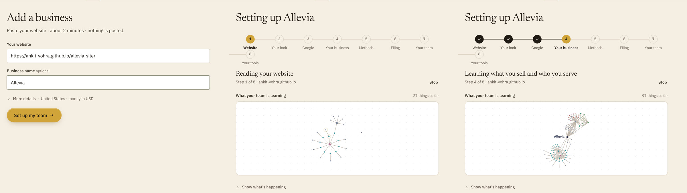

| | |
|---|---|
|  | 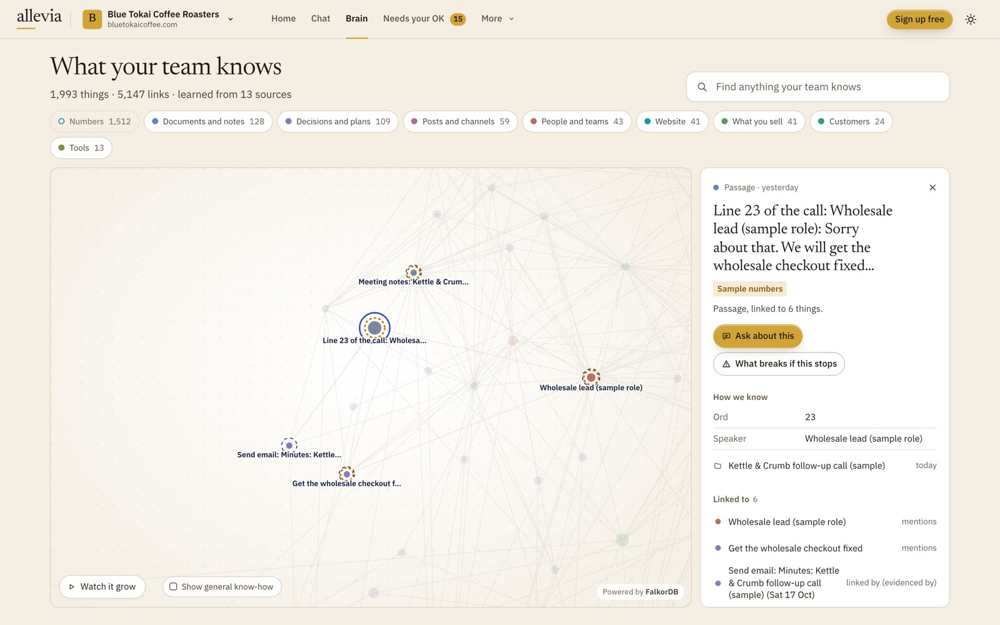 |
| **Meetings arrive by themselves.** A Fireflies call becomes minutes; each action goes to Deal Closer, Techie or Miss Influencer, and points at the exact line it came from. | **Provenance you can click.** That line is a node in the graph, linked to its speaker, the task and the minutes. |
| 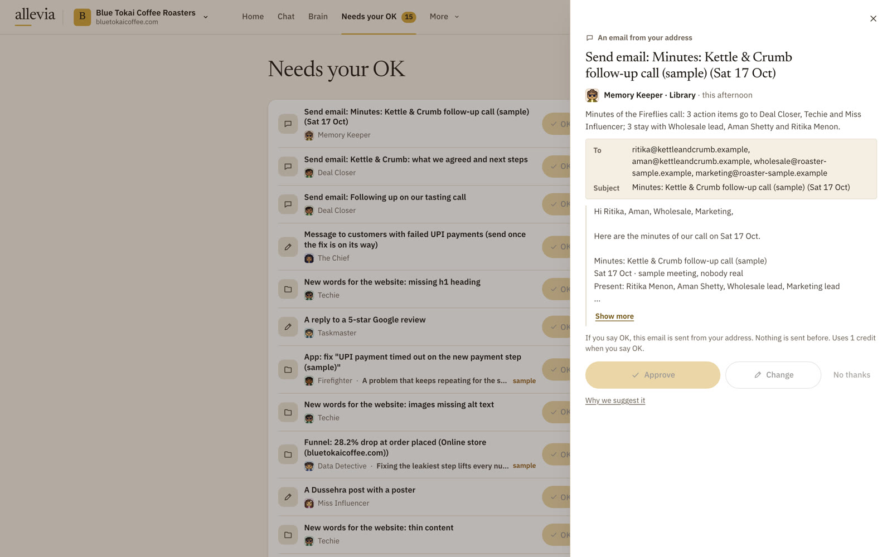 | 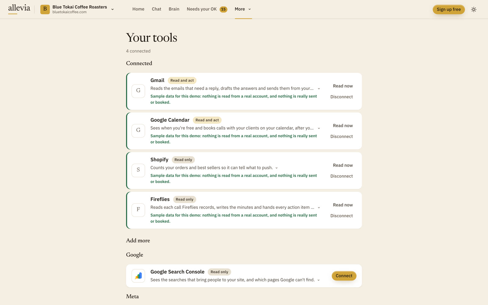 |
| **Nothing goes out without your OK.** Every email, post, ad change and fix is a card with its evidence. | **Works from your own tools.** Composio connects 1,000+ apps; each reads into the same brain. |
| 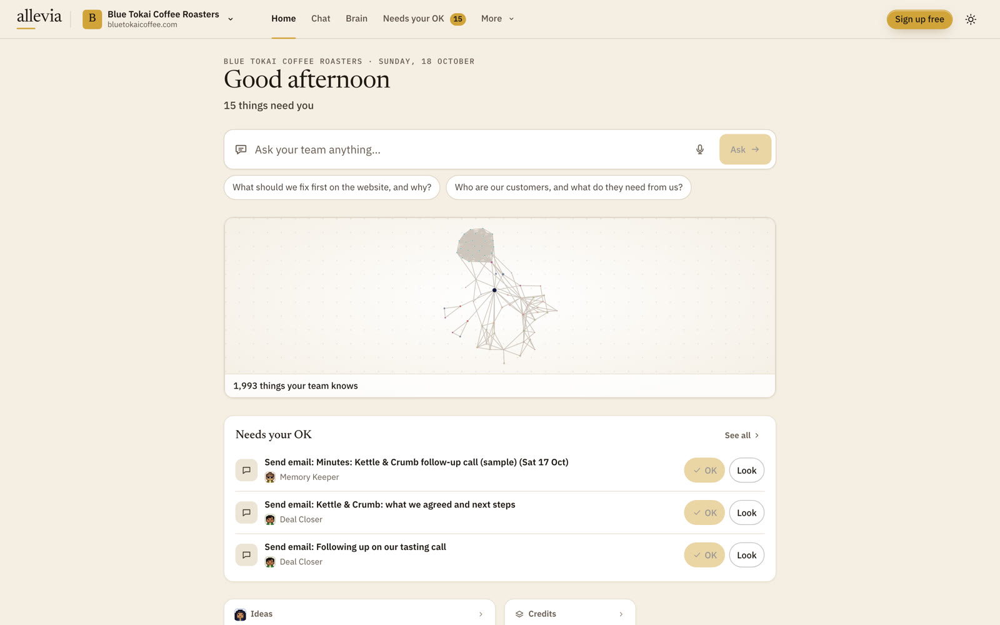 | 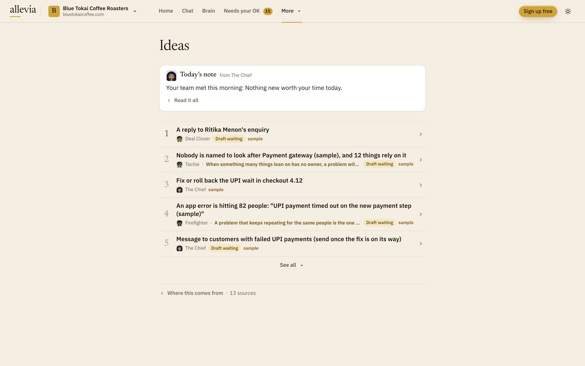 |
| **Home.** Ask anything; see what waits on you. | **The team notices things.** Daily stand-up findings, each drafted for your OK. |

## The problem

A founder holds the whole business in their head: why a price changed, what was promised to which client, what shipped on
Monday. The inbox, analytics, ads and website don't talk to each other, so every "why" comes back to the founder.

Most AI tools start each chat from nothing, or from a pile of pasted documents. They can find text that sounds like the
question, but they can't tell you that a payment error began the day of a release, or that the release changed the payment
page. Those are links, and links live in a graph.

## What it does

- **A team of 13, in a pixel office.** The Chief (Chief of Staff) takes each request and sends it to the right desks:
  Data Detective (Analytics), Growth Hacker (Marketing), Miss Influencer, Wordsmith and Fact Checker (Content Studio), Techie,
  Firefighter and Bug Hunter (Tech), Number Cruncher (Center of Excellence, a second check on every figure), Deal Closer
  (Sales), Taskmaster (Operations) and Memory Keeper (Library). Every agent is an `Agent` node in the graph, and every step and
  handoff shows in the office and the work log. The roster is [`shared/roster.ts`](shared/roster.ts).

- **Every answer comes with its path through the graph.** The answer cites node ids; the server checks that each cited node
  was returned by a tool in that turn and that each number appears in the tools' data. A failed check shows as "unverified",
  never hidden ([`src/agent/checks.ts`](src/agent/checks.ts)). The Chief ends by naming the nodes behind the answer, and the
  app lights that path on the map.

  

- **A brain you can see.** The Brain page draws the business's graph, shows "what breaks if this stops" one step away against
  up to four, and shows how the brain grew from its own facts (`npm run cli -- graph:story <business>`).

  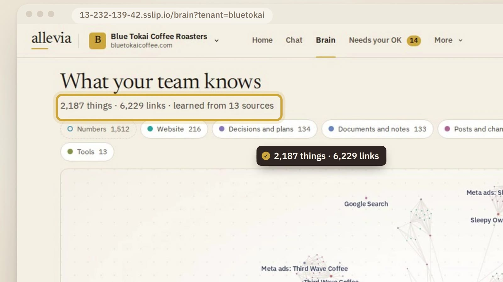

- **One-tap approvals, on the web and in Discord.** Anything that spends money, goes public or contacts someone becomes an
  approval card with its evidence: approve, change or reject. When the founder edits a draft before approving it, the edit
  becomes a learned `Rule` linked to that approval, and later drafts apply it ([`src/actions/`](src/actions)).

  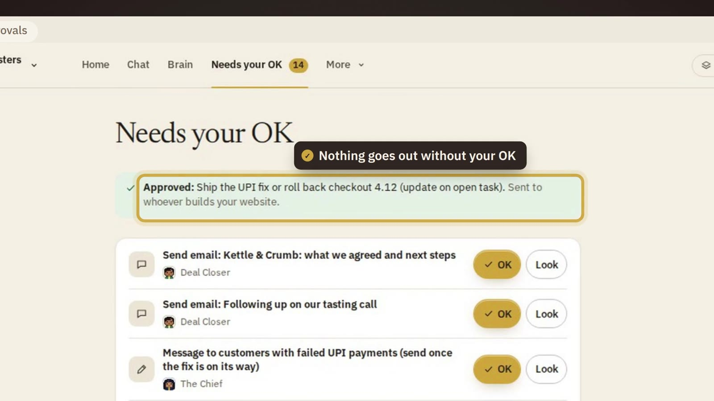

- **Meetings arrive by themselves.** A call recorded by Fireflies or Granola (through Composio), or a transcript posted to the
  business's own meeting address, becomes minutes, decisions and tasks in the graph with nobody pasting anything. Every line of
  the call is a `Chunk` linked to who said it; each decision is `BASED_ON` its line and each action points back at the line it
  came from. Each action goes to the right person or AI teammate (a quote to Deal Closer, a checkout fix to Techie), and the
  minutes email waits for the founder's OK ([`src/meetings/`](src/meetings)).

- **Memory that keeps history.** Every edge carries when it was true and when it was recorded. A fact that stops being true is
  closed with a date and kept, so the brain remembers what changed and when, and every tool can answer "as of" a past date.

  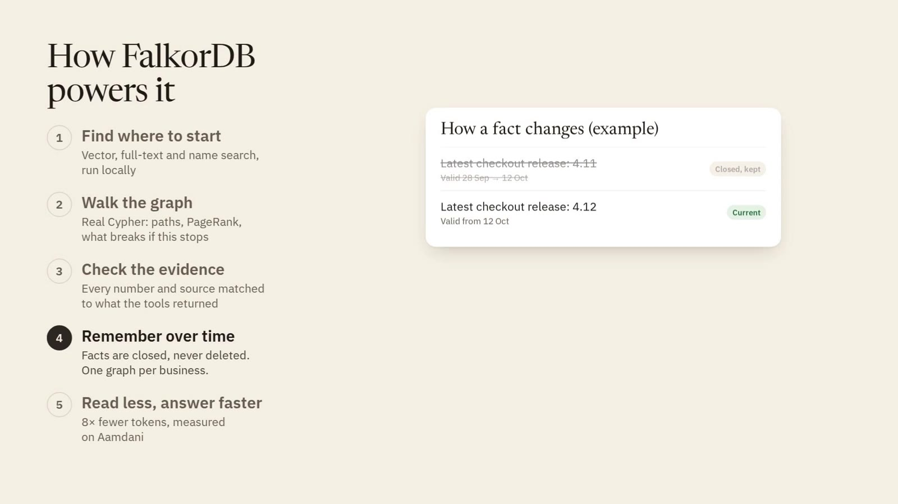

- **Built from the founder's own sources.** Onboarding reads the business's website (pages, products, brand kit, SEO checks);
  connections go through Composio (Gmail, Calendar, Analytics, Search Console and Instagram are connected for real on Aamdani);
  public data (Google listing, public Instagram, ad libraries) comes through Apify. Also: a Studio for posters and product
  photos, a CLI for everything, and a read-only MCP server so other agents can use the brain.

## How FalkorDB is used

Each business gets its own FalkorDB graph (`allevia_<slug>`), beside a registry graph (`allevia_meta`) and a shared, read-only
graph of general know-how (`allevia_reference`). The agents cannot answer without walking the graph: their 21 graph tools are
Cypher queries and graph algorithms. Every query, with its file, line and parameters, is in
[`docs/falkordb-queries.md`](docs/falkordb-queries.md), and a test keeps that page in step with the code.

| Problem | How FalkorDB solves it | Where |
|---|---|---|
| Keeping businesses apart | Isolation is the graph boundary: no query filters by tenant, and no agent tool takes a graph name | [`src/graph/tenants.ts`](src/graph/tenants.ts) |
| Finding where to start | Vector indexes (384-dimension multilingual e5 embeddings, made locally) and full-text indexes on a `Searchable` label and on text chunks, merged by reciprocal rank. A chunk hit answers as its source document, so citations point at sources | [`src/graph/indexes.ts`](src/graph/indexes.ts), [`src/agent/tools/search.ts`](src/agent/tools/search.ts) |
| Explaining "why" | `algo.SPpaths` joins up the path drawn under each answer. A hop-by-hop walk over `DEPENDS_ON`, `AFFECTS` and `BLOCKS` answers "what breaks if this stops". `algo.pageRank` ranks what matters; `algo.labelPropagation` groups topics; `algo.WCC` finds orphaned knowledge | [`src/graph/algorithms.ts`](src/graph/algorithms.ts) |
| Remembering change | Every edge has two clocks (`since`/`until` for when it was true, `recordedAt`/`retiredAt` for when we recorded it), plus `src` and `asOf`. Facts are closed, never deleted; every tool takes `asOf`. Changed tasks, decisions and goals keep their old state as a `Version` node one hop away | [`src/graph/upsert.ts`](src/graph/upsert.ts) |
| History inside graph algorithms | `algo.*` can't filter on edge properties, so closed edges carry a high `closedCost` that `SPpaths` prunes with `maxCost`; PageRank and topics run on a cached projection of current edges | [`src/graph/projection.ts`](src/graph/projection.ts) |
| "Where did this action come from?" | A meeting's transcript is split into line `Chunk`s (`HAS_CHUNK`, each `MENTIONS` its speaker); a decision is `BASED_ON` the line it was agreed in and the line `MENTIONS` each task, so the answer cites the task and its line, and the path runs line → action. Named by the recorder's own meeting id, so a second read writes nothing | [`src/agent/meeting.ts`](src/agent/meeting.ts), [`src/meetings/lines.ts`](src/meetings/lines.ts) |
| Checking answers | Metric readings are `Observation` nodes with a window, a date and a source, never overwritten properties. The server checks every cited node and number against that turn's tool results | [`src/agent/checks.ts`](src/agent/checks.ts) |
| Safe agent Cypher | The agents' raw Cypher tool runs through `GRAPH.RO_QUERY`, with a procedure allow-list and a 5-second timeout | [`src/agent/tools/cypher.ts`](src/agent/tools/cypher.ts) |
| Keeping the graph clean | A write gate refuses a node without a known type, a source and a date; shared know-how lives once in the reference graph | [`src/graph/gate.ts`](src/graph/gate.ts), [`src/graph/reference.ts`](src/graph/reference.ts) |

The shortest-path call behind every answer's path, from [`src/graph/algorithms.ts`](src/graph/algorithms.ts):

```cypher
MATCH (a:Entity {id:$from}), (b:Entity {id:$to})
CALL algo.SPpaths({sourceNode: a, targetNode: b, relDirection: 'both', maxLen: $maxLen, pathCount: $pathCount,
  relTypes: $rels, costProp: 'closedCost', maxCost: $maxCost})
YIELD path RETURN path
```

**Data model.** Every node has the base label `Entity` and a unique `id` (`<type>:<slug>`, with a range index and UNIQUE and
MANDATORY constraints). Memory lives in the same graph as the business: `Turn`, `Finding`, `Memory`, `Rule`, `Approval`. Agents
hand work to each other through `Finding` nodes. All 38 node types and 54 relationship types are in
[`src/graph/schema.ts`](src/graph/schema.ts). The part that carries an answer and the memory loop:

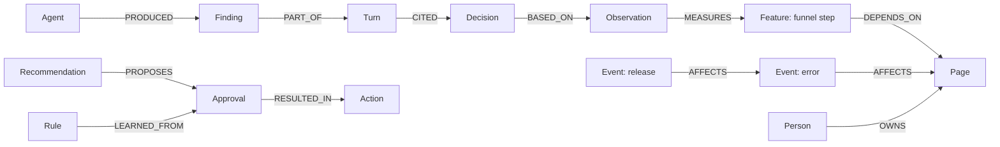

**What we hit.** On FalkorDB 6.0.2 we found query shapes that crash the server (a tied full sort over rows with nullable maps,
and NaN in a sort key). They are written up in [`docs/notes/`](docs/notes/falkordb-nan-crash.md), refused client-side before
they are sent, and held out of `src/` by a static test.

## Architecture

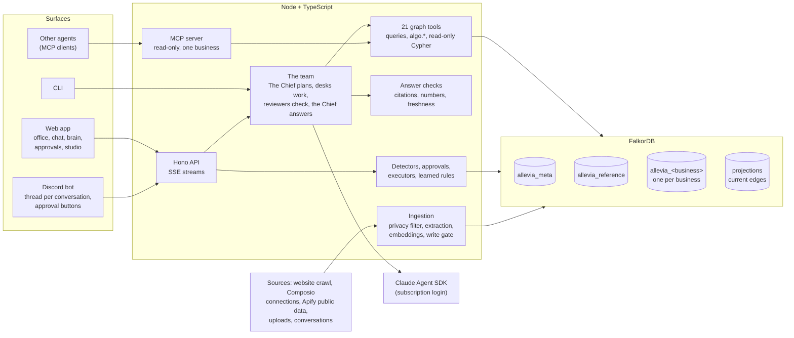

A request: recall what the graph already knows about the question; The Chief plans which desks to use; each desk runs as its
own Agent SDK query with only its tools and writes a `Finding`; the reviewers named in the roster check it; The Chief writes the
answer, calls `show_path` and may propose an approval card. The turn, its findings, reviews and full event log are written back
to the graph.

## Try it

**[13-232-139-42.sslip.io](https://13-232-139-42.sslip.io)** has three businesses, open read-only to visitors:

- **Blue Tokai Coffee Roasters**, a known Indian coffee roaster. Its public side is real (website, products and prices, Google
  listing, public Instagram, ad libraries). Its private side (orders, payments, ad spend, inbox) is **sample numbers**, labelled
  as samples on every screen. Ask: "Why did online orders drop this week, and what should we do?" The answer walks from the
  drop in online orders to UPI payments timing out, the payment error and the checkout release that brought it, and rules out
  an Instagram dip that came nine days earlier. What is real and what is sample: [`docs/demo-bluetokai.md`](docs/demo-bluetokai.md).
- **Aamdani**, our own startup (Allevia grew out of running it), with Gmail, Calendar, Analytics, Search Console and Instagram
  connected for real.
- **AVS Atelier**, an architecture and interiors studio, built from its website and Instagram.

The five scenarios we run live are in [`docs/live-scenarios.md`](docs/live-scenarios.md).

## Run it locally

The local demo uses **Shiftly**, a synthetic shift-jobs app that ships with the repository (no private data). Its hero
question: "Why did sign-ups drop this week, and what should we do?" The agents run on a claude.ai subscription login through the
Claude Agent SDK, never on an API key ([`src/agent/sdk-env.ts`](src/agent/sdk-env.ts)).

**1. Look first, no accounts** (Docker with Compose v2.24 or later). The read-only demo replays four recorded team answers with
their work logs and lit paths:

```sh
git clone https://github.com/Ankit-Vohra/allevia-company-brain.git allevia && cd allevia
docker compose up -d --build                                  # FalkorDB 6.0.2 and Allevia on http://127.0.0.1:8787
docker compose exec app tsx src/cli.ts seed-demo --recorded   # Shiftly with four recorded answers
open http://127.0.0.1:8787                                    # FalkorDB Browser: http://127.0.0.1:3090
```

**2. Run the team live** (Node 22 or later, Docker for FalkorDB, Claude Code logged in: run `claude`, then `/login`):

```sh
npm install && (cd web && npm install && npm run build)   # the API serves web/dist
docker compose up -d falkordb                             # FalkorDB on 127.0.0.1:6390
npm run cli -- db:check                                   # "FalkorDB at redis://127.0.0.1:6390: ok"
npm run cli -- seed-demo                                  # Shiftly, no recorded answers
npm run cli -- serve                                      # http://127.0.0.1:8787 (add --public for the read-only demo)
npm run cli -- ask demo_growth "Why did sign-ups drop this week, and what should we do?"
```

Optional:
- Settings (Discord, Composio, Apify) go in `~/.config/allevia/allevia.env`; every name is documented in
  [`.env.example`](.env.example), and none is needed for the steps above.
- Local embeddings ($0, no network after the first download): `npx tsx scripts/spikes/embeddings.ts` fetches
  `Xenova/multilingual-e5-small` into `models/`. Without it, search is full-text only.
- Onboarding a business from its website needs Chromium: `npx playwright install chromium` (or `WITH_CHROMIUM=1` for the
  Docker build), then `npm run onboard -- --name "…" --slug … --url https://…`.
- A port is taken (6390, 3090, 8787): `FALKORDB_PORT=6395 FALKORDB_BROWSER_PORT=3095 ALLEVIA_PORT=8795 docker compose up -d`.
- FalkorDB settings (`THREAD_COUNT`, timeouts, `RESULTSET_SIZE` and the rest) are module load arguments in
  [`docker-compose.yml`](docker-compose.yml), explained in [`src/graph/server-config.ts`](src/graph/server-config.ts).

Useful CLI commands (`npm run cli` lists them all):

| Command | What it does |
|---|---|
| `ask <business> "<question>"` | Ask the team and watch every agent's steps in the terminal |
| `insights <business>` | Run the deterministic detectors; write recommendations and approval cards |
| `approvals <business> [approve\|reject <id>]` | List or decide approval cards (`--edit <file>` teaches a learned rule) |
| `graph:story <business>` | How the brain grew: nodes and edges per day, from the graph's own clocks |
| `mcp --tenant <business> [--http]` | The read-only MCP server for one business |
| `db:check` / `db:migrate` / `db:usage` | Check FalkorDB and its settings; bring graphs to the current schema; memory per graph |
| `privacy-scan <business>` | Scan every string in a business's graph for secrets and personal data |

**Tests.** About 3,400 vitest tests run against a real FalkorDB in throwaway graphs, including a static scan that holds every
Cypher string in `src/` to the crash rules and a `GRAPH.EXPLAIN` check that id lookups use the index. Start a throwaway FalkorDB
(`docker run -d -p 127.0.0.1:6391:6379 falkordb/falkordb:6.0.2`), then `npm test`. Eval sets are in [`evals/`](evals), reports
in [`docs/evals/`](docs/evals).

## Repo map

| Path | What |
|---|---|
| `src/graph/` | FalkorDB client and crash guards, schema, two-clock upsert, algorithms, projections, indexes, tenants, write gate, reference graph |
| `src/agent/` | The team: orchestrator, Agent SDK runtime, tools (21 of them graph queries and algorithms), answer checks, memory |
| `src/ingest/`, `src/onboard/` | Sources, privacy filter and redaction, extraction, embeddings; onboarding a business from its website |
| `src/insights/`, `src/actions/` | Deterministic detectors and the morning brief; approvals, executors and learned rules |
| `src/connections/`, `src/publicdata/` | Connected tools through Composio, with a sealed per-business store and audit log; public data through Apify |
| `src/server/`, `web/` | Hono API and the React web app (Vite) |
| `src/discord/`, `src/mcp/`, `src/studio/` | Discord bot, MCP server, the photo and poster Studio |
| `src/demo/` | Shiftly, the synthetic business, and its recorded answers |
| `shared/` | Contracts and the team roster, shared by server, web and site |
| `site/` | The public website |
| `evals/`, `tests/` | Eval sets and runner; the test suite |
| `docs/` | The queries doc, live scenarios, the blog post and its images, design and setup notes |
| `skills/`, `vendor/` | Plain-language playbooks the agents open; third-party playbook data with its licences |

## Measured results

On 17 October we measured tokens and time on Aamdani, with two real questions ("What breaks if the Instagram token expires?" and
"Why did we pause daily stories and image posts?"), the same model and the same answer rules, three ways. Script:
[`scripts/bench-efficiency.ts`](scripts/bench-efficiency.ts); write-up: [`docs/graph-audit.md`](docs/graph-audit.md).


| Way of answering | Tokens read (two questions) | Time |
|---|---|---|
| Paste all 114 documents into the prompt | 604,000 | 22 s each |
| One agent with only the graph tools | **75,000 (8× fewer)** | 13 s each (43% less) |
| The full 13-agent team | 175,000 (3.5× fewer) | 26 to 44 s |

The graph agent's tools handed it only 1,200 to 2,100 tokens of the business's own records per answer.

Honest limits:
- The full team reads more than one agent and is slower than pasting, because it plans, reviews and checks facts. What it buys
  is a checked answer with citations and a path.
- On Shiftly, our small synthetic company (about 6,300 tokens of documents), pasting was cheaper than the agents. The graph wins
  as the business grows.
- Five questions on two businesses is a measurement, not a benchmark suite.
- Three businesses are live. Real connected tools are proven on Aamdani; on Blue Tokai the private numbers are samples.
  Actions in the outside world (posts, emails, GitHub issues, ad changes) are dry runs until `ALLEVIA_ACTIONS_LIVE=1`; ad data
  is simulated and always marked.

## Built in four days

Allevia was built from 15 to 18 October 2026, during the hackathon. The first commit is at 01:08 IST on 15 October, and the
history has more than 800 commits: see the [commit history](https://github.com/Ankit-Vohra/allevia-company-brain/commits/). Claude Code,
with subagents in parallel git worktrees, wrote most of the code, tests and docs under the founder's direction and review;
Claude, through a claude.ai subscription login, runs the 13 agents. Reused, not written here: npm libraries and the vendored
third-party data and skills credited in [`NOTICE.md`](NOTICE.md).

## Licence

MIT, see [`LICENSE`](LICENSE). Vendored third-party data and skills keep their own licences ([`NOTICE.md`](NOTICE.md),
[`vendor/`](vendor)).
