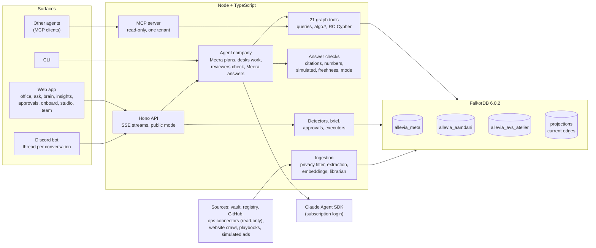

# Allevia

**A done-for-you AI growth team for small businesses, with a company brain in FalkorDB behind every answer.**

Twelve AI staff in eight departments share one knowledge graph per business. They answer "why" with the path through
the graph that proves it, remember what the owner taught them, and turn findings into one-tap approvals. Built in
India for owner-run businesses in the US, UK, UAE and Australia.

Entry for **Graph Hacks: Context for AI Agents** (WeMakeDevs × FalkorDB, 15–18 Oct 2026), all three tracks. The
first two businesses on it are real: **Aamdani** (a Hindi-first jobs platform, from its operating vault and read-only
connectors) and **AVS Atelier** (an architecture studio, from nothing but its website URL).


---

## The problem

Most small businesses have tried AI. Very few have AI doing a job in the business.

- **US:** 76% of engaged owners use AI, but only 14% have it fully integrated into core operations (Goldman Sachs
  10,000 Small Businesses, n=1,256, 2026). Census BTOS puts any-function use at 17–20% of firms, under 20% below
  five staff.
- **UK:** 29% of firms use AI, and adopters went from 1.4 to 1.6 technologies in three years: "widening, not
  deepening" (ONS, TechMarketView).
- **UAE:** 72% say they use AI; transaction data from 6,000 firms shows 12% pay for an AI tool (Pemo).

The gap between "I've tried ChatGPT" and "an AI does a job here" is 50 points or more in each market. Owners name the same
blockers: no clear use case, no skills, no time, no trust in the numbers, and nobody to keep it running when a token
expires or a model changes. Tools that sell brand memory and prompt-free content exist. We found none that joins
Search Console, GA4, Instagram and the company's own decisions into one memory and answers "why" with evidence.

Allevia's answer: set it up once for the owner (the plan is a 15-minute setup, then a team in India keeps it
running), give the owner a team instead of a tool, and make every answer carry its receipts. Sources and pricing method:
[product design](docs/superpowers/specs/2026-10-15-allevia-product-design.md) §0 and §4.

## What it does

- **A twelve-person company in a pixel office.** Meera (Chief of Staff) plans each request and sends it to the right
  desks: Isha (Center of Excellence, checks every number), Kabir (Analytics), Rohan (Marketing), Tara, Dev and Nisha
  (Content Studio: strategist, copy editor, fact checker), Arjun, Zoya and Imran (Tech: tech lead, on-call engineer for
  Sentry errors and crashes, QA and release manager for builds and the app stores), Vikram (Operations) and Sara
  (Library). Every
  agent is an `Agent` node in the graph, every step streams to the office and the work log, and every handoff is
  visible. The roster is [`shared/roster.ts`](shared/roster.ts).
- **Every answer comes with its graph path.** The answer cites node ids; the server checks each citation was returned
  by a tool in this turn, each number appears in tool data, simulated data is called simulated, stale data says
  "as of", and non-API data says where it came from. A failed check shows an "unverified" badge; it is never hidden
  ([`src/agent/checks.ts`](src/agent/checks.ts)). The final step draws the path through the graph that supports the
  answer, and the web app lights it up.
- **Memory that compounds.** Threads, findings, approvals and the owner's notes are written back to the graph, and the
  next thread recalls them from it. When the owner edits a draft before approving it ("villa" to "home"), the edit
  becomes a learned `Rule` linked to that approval, later drafts apply it, and the first-pass approval rate is tracked
  day by day on the Allevia 90 scorecard ([`src/actions/learning.ts`](src/actions/learning.ts),
  [`src/program/scorecard.ts`](src/program/scorecard.ts)).
- **One-tap approvals.** Anything that would change the outside world becomes an approval card: a GitHub issue, a
  content draft, a (simulated) ad pause, a Discord post. Approve, edit or reject, from the web or Discord. GitHub
  issues and Discord posts are dry runs unless `ALLEVIA_ACTIONS_LIVE=1`; drafts are never published.
- **Insights without model guesswork.** 20 deterministic Cypher detectors (SEO, content, funnel, simulated ads,
  knowledge gaps, and on-call and release health for the app) produce findings with evidence ids and numbers from the
  graph; Today's note (the morning brief) is a goal pulse built from them, with an "On call" section only when Zoya or
  Imran has something open ([`src/insights/`](src/insights)).
- **Answers a busy owner can act on.** The Chief of Staff leads with the answer, numbers the steps, ranks at most five
  items and ends on one next action, in plain words (no "baseline" or "agent"). The shape follows the MIT-licensed
  [i-have-adhd](vendor/skills/i-have-adhd/NOTICE.md) rules and [`docs/owner-words.md`](docs/owner-words.md)
  ([`src/agent/style.ts`](src/agent/style.ts)).
- **Onboarding from a URL.** A polite, SSRF-safe crawler reads the site, builds the brand kit, runs SEO checks, maps
  services, audiences and needs, and enrols the business in a 90-day program with goals and Day-0 baselines
  ([`src/onboard/`](src/onboard), [`src/ingest/sources/website/`](src/ingest/sources/website)).
- **Studio (thin slice).** A phone photo goes in with EXIF stripped; Tara assesses it, a local variant and a
  generated variant come out, Nisha's fidelity check compares each against the original and marks any structural
  change, Dev writes the caption, and the owner approves ([`src/studio/`](src/studio)). In the recorded demo Nisha
  held back the generated edit because it added details that are not in the original photo.
- **Other surfaces.** A Discord bot (a thread per conversation, live work log, approval buttons), a read-only MCP server
  for other agents, a CLI for everything, and a static marketing site with pricing in four currencies (`site/`).

## How FalkorDB is central

The agents cannot answer without walking the graph: every tool is a graph query or a graph algorithm, and the answer's
path is checked against the graph before it is drawn.

| FalkorDB capability | How Allevia uses it |
|---|---|
| **Multi-graph tenancy** | One graph per business (`allevia_<slug>`) plus a registry graph (`allevia_meta`). A request is bound to one tenant's graph; no tool takes a graph name ([`src/graph/tenants.ts`](src/graph/tenants.ts)). |
| **Bi-temporal facts and versions** | Every relationship carries valid time (`since`/`until`) and record time (`recordedAt`/`retiredAt`); nothing is deleted, a contradicted fact is closed. Changing entities write a `Version` before an update, so history is one hop away and every tool accepts `asOf` for time travel ([`src/graph/upsert.ts`](src/graph/upsert.ts)). |
| **Provenance on every fact** | Nodes and edges carry `src` (the source document) and `asOf`; extracted facts carry `conf` and `SOURCED_FROM`. Numbers are always `Observation` nodes with a window and a date, never overwritten properties. |
| **Read-only Cypher, guarded** | The `cypher` escape hatch runs `GRAPH.RO_QUERY` with a 5 s server timeout, a write-keyword and procedure allow-list check, bounded `range()`/`reduce()`, and capped output ([`src/agent/tools/cypher.ts`](src/agent/tools/cypher.ts)). |
| **Graph algorithms as agent tools** | `algo.SPpaths` for `find_paths` and the answer path (`show_path`), `algo.pageRank` for `important`, `algo.labelPropagation` for `topics`; the librarian stores PageRank and community ids and uses `algo.WCC` to report orphaned knowledge. `impact_of` walks `DEPENDS_ON`/`AFFECTS`/`BLOCKS` and scores the result by betweenness ([`src/graph/algorithms.ts`](src/graph/algorithms.ts)). |
| **Projections** | `algo.*` cannot filter on edge properties, so ranking and community algorithms run on a slim, cached projection graph of the currently valid edges (or of the edges valid at `asOf`), rebuilt when a write lands ([`src/graph/projection.ts`](src/graph/projection.ts)). |
| **Vector + full-text indexes** | 384-dim cosine vector indexes on entities and document chunks (local multilingual e5 embeddings, English and Hindi) and full-text indexes on names, summaries and chunk text, fused by reciprocal rank in `search` ([`src/graph/indexes.ts`](src/graph/indexes.ts), [`src/agent/tools/search.ts`](src/agent/tools/search.ts)). |
| **Memory in the graph** | `Session`, `Turn` (with `TOUCHED` and `CITED` edges and the full event log), `Finding`, `Memory`, learned `Rule`s with `LEARNED_FROM`, `GUIDED_BY` from a finding to the owner instruction it followed. Agents hand off through Findings stored in the graph. |
| **MCP** | `npm run cli -- mcp --tenant <slug>` serves 11 read-only graph tools for one tenant over stdio or Streamable HTTP, so another agent can use the company brain ([`docs/jarvis-integration.md`](docs/jarvis-integration.md)). |
| **FalkorDB Browser** | The compose file publishes it on 127.0.0.1:3090 for exploring the tenant graphs directly. |

The ontology has 38 node types and 54 relationship types ([`src/graph/schema.ts`](src/graph/schema.ts)). On
15 October the Aamdani graph held about 3,700 nodes and 11,300 edges, and AVS Atelier's about 460 nodes and 2,000
edges.

We built on FalkorDB 6.0.2 and found two query shapes that crash it (a tied full sort over rows with nullable maps,
and NaN in a sort key). They are measured and reproduced in
[`docs/notes/falkordb-nan-crash.md`](docs/notes/falkordb-nan-crash.md), refused client-side before they are sent,
and held out of `src/` by a static test.

## Tracks

| Track | Where it shows |
|---|---|
| **01 Agents that act on connected data** | 21 graph tools (paths, PageRank, communities, impact with betweenness, decisions, ownership, metrics, SEO, ads, playbooks, read-only Cypher); recommendations backed by graph evidence, approval cards, executors that record an `Action`; MCP server. |
| **02 Agent memory and coordination** | Episodic (Session, Turn, Approval, Action), semantic (the company graph and the owner's Memory notes) and procedural (vendored playbook Rules plus learned Rules) memory; twelve agents coordinating through Findings in a shared graph; one graph per tenant. |
| **03 Company brain** | A real company's vault, decisions, pending list, GitHub issues and Allevia's own threads in one graph; `OWNS` and `KNOWS_ABOUT` for who owns and who knows; `trace_decision` from a decision to its evidence and deciders; bi-temporal facts and a librarian that closes contradicted ones; answers with checked citations. |

## Architecture



A request: recall what the graph already knows about the question; Meera returns a plan (one to three desks); each
desk runs as its own Agent SDK query with only its tools and writes a Finding; the reviewers named in the roster
check it; Meera writes the answer, calls `show_path`, and may propose an action. The Turn, Findings, reviews and the
full event log are written to the graph, which is what makes replay possible. Design:
[engineering spec](docs/superpowers/specs/2026-10-15-allevia-design.md) §4–§9 and §16.

## Screenshots

| | |
|---|---|
|  |  |
| **Ask.** The answer cites nodes, the work log shows who did what, and the path behind the answer is lit (synthetic demo company). | **Your 90 days.** Goals against the Day-0 baseline, the first-pass curve and learned rules (Aamdani, read-only). |
|  |  |
| **Approvals.** An edit becomes a learned rule that later drafts apply; executors are dry runs by default. | **Tell your team.** A plain-language instruction previewed as a change before it applies. |
|  |  |
| **Onboard.** The brain built from a website (web app in mock mode). | **Site.** Home and pricing in four currencies, generated from `shared/plans.ts`. |

More, in light and dark and on mobile: [`docs/screenshots/`](docs/screenshots).

## Run it

### Public demo with Docker (no model needed)

Needs Docker with Compose v2.24 or later.

```sh
docker compose up -d --build                # FalkorDB 6.0.2 + Allevia on http://127.0.0.1:8787
```

The app starts in **public mode** (`ALLEVIA_PUBLIC_MODE=1`): the office, brain explorer, insights, approvals history
and scorecard read live from the graph; every write is refused; Ask replays recorded showcase turns instead of
calling a model. A fresh FalkorDB is empty, so load something first:

```sh
# the synthetic demo company: a small graph with real structure and made-up data (no model calls)
docker compose exec app tsx scripts/seed-demo.ts demo_seed --register
docker compose exec app tsx src/cli.ts enroll demo_seed --country UK --industry "jobs platform"
docker compose exec app tsx src/cli.ts insights demo_seed   # deterministic detectors, approval cards
docker compose exec app tsx src/cli.ts brief demo_seed      # today's note (the morning brief)
```

Then open http://127.0.0.1:8787: the office, the 90-day card, the brain explorer, insights and approval cards for
"Demo Seed". The FalkorDB Browser is on http://127.0.0.1:3090. The demo company has no recorded showcase turns, so
Ask has nothing to replay in public mode; the hosted demo carries the recorded Aamdani and AVS Atelier turns.

### Live mode (needs your own Claude login)

The agents run on the [Claude Agent SDK](https://github.com/anthropics/claude-agent-sdk-typescript) with a claude.ai
subscription login, never an API key: `ANTHROPIC_API_KEY` is stripped from the SDK's environment, and a run stops if
the SDK reports any API-key source ([`src/agent/sdk-env.ts`](src/agent/sdk-env.ts)). A public deployment therefore
cannot offer live chat to strangers. An evaluator with their own Claude account can run it live:

- **Recommended, on your machine:** install [Claude Code](https://docs.claude.com/en/docs/claude-code), run
  `claude` and `/login` with your claude.ai account, then follow the development setup below and run
  `npm run cli -- serve` (live mode is the default outside Docker). This is the path the eval runs used.
- **In Docker:** create a long-lived token with `claude setup-token`, put `CLAUDE_CODE_OAUTH_TOKEN=<token>` and
  `ALLEVIA_PUBLIC_MODE=0` in `.env`, and `docker compose up -d`. The SDK passes that token through; this path was
  not exercised in our runs, so if the subscription guard refuses it, use the local route.
- Onboarding from a URL needs Chromium for the crawler: `WITH_CHROMIUM=1 docker compose build`.

### Development setup

Node 22 or later (24 recommended), Docker for FalkorDB.

```sh
npm install && (cd web && npm install)
docker compose up -d falkordb                  # FalkorDB on 127.0.0.1:6390, the CLI's default
mkdir -p ~/.config/allevia && cp .env.example ~/.config/allevia/allevia.env && chmod 600 ~/.config/allevia/allevia.env
(cd web && npm run build)                      # the API serves web/dist; or `cd web && npm run dev` on :5173
npm run cli -- db:check
npx tsx scripts/seed-demo.ts demo_seed --register   # the synthetic demo company, as in the Docker quick start
```

The env file is optional: every name has a default, and secrets (a Discord bot token, for example) live only there,
outside the repo. Local embeddings are optional too ($0, no network after the first download): `npx tsx
scripts/spikes/embeddings.ts` fetches `Xenova/multilingual-e5-small` (about 130 MB) into `models/`. Without it, search
is full-text only.

### FalkorDB settings and schema

`docker-compose.yml` starts FalkorDB with the limits the code is written for, as module load arguments (`FALKORDB_ARGS`:
`THREAD_COUNT 4`, `MAX_QUEUED_QUERIES 500`, `TIMEOUT_DEFAULT 15000`, `TIMEOUT_MAX 120000`, `QUERY_MEM_CAPACITY 536870912`,
`CACHE_SIZE 256`, `RESULTSET_SIZE 10000`; what each is for is in [`src/graph/server-config.ts`](src/graph/server-config.ts)).
Load arguments survive a restart and `GRAPH.CONFIG SET` does not, so a running server picks them up with
`docker compose up -d falkordb`, and `npm run cli -- db:check` reports one that differs.

Every tenant graph is brought to the same schema when it is created and again at the start of every ingest
([`src/graph/indexes.ts`](src/graph/indexes.ts), [`migrate.ts`](src/graph/migrate.ts)); `npm run cli -- db:migrate [tenant]`
runs it on demand. The schema is: a range index on `Entity.id` with UNIQUE and MANDATORY constraints (duplicate ids already in a graph
are merged first); range indexes on `Observation.metric`, `metricKey` (the lowercase metric, so no read wraps it in
`toLower()`), `subject` and `asOf`; the `Searchable` label on the types search returns, with the full-text and vector
indexes on it, so a reading's name never competes with an entity's. Queries look nodes up as `(n:Entity:Type {id:$id})`
(the index is on `Entity.id`), and bind the edge under every count (`WHERE ID(e) >= 0`) because FalkorDB 6.0.2 collapses parallel
edges nothing refers to; the suite holds both rules (see Tests).

### CLI

`npm run cli -- <command>` (`npm run cli` lists them all). The main ones:

| Command | What it does |
|---|---|
| `ingest <tenant> [--sources brain,ops,playbooks,simads,github]` | Ingest a configured tenant's sources (privacy filter, extraction on the subscription, embeddings, librarian, privacy scan) |
| `npm run onboard -- --name "…" --slug … --url https://…` | Onboard a business from its website (crawl, brand kit, SEO checks, understanding, program) |
| `enroll <tenant>` | Enrol a business already in the graph in Allevia 90: country defaults, goals, Day-0 baselines, capabilities |
| `ask <tenant> "<question>"` | Ask the agent company and watch every agent's steps in the terminal |
| `insights <tenant>` | Run the 20 detectors; write recommendations and approval cards |
| `brief <tenant>` | Write today's note (goals, what changed, what we noticed, on call, waiting for your OK, next step) |
| `approvals <tenant> [approve\|reject <id>]` | List or decide approval cards (`--edit <file>` teaches a learned rule) |
| `program <tenant> [--read-only]` | The Allevia 90 scorecard |
| `tell <tenant> "<instruction>"` | "Tell your team": preview a plain-language change, `--apply` to make it |
| `serve [--public]` | The API and the web app on one port |
| `discord [--tenant aamdani]` | The Discord bot (needs a bot token in the env file) |
| `mcp --tenant <slug> [--http]` | The read-only MCP server for one tenant |
| `eval <tenant> [--fake]` | Run the tenant's eval questions, score every turn, write `docs/evals/<date>-<tenant>.md` |
| `showcase <tenant> [<turnId>]` | Mark a stored turn for public replay, or list the showcase turns |
| `db:check` / `db:migrate [tenant…]` | Ping FalkorDB and compare its settings with `docker-compose.yml`; bring tenant graphs up to the current schema |
| `privacy-scan <tenant>` | Scan every string in a tenant's graph for secrets and personal data (must report 0) |

## Tests and evals

- **1,493 tests pass** (2 more skipped) in 117 files (vitest), run against a real FalkorDB in throwaway graphs: unit tests,
  integration tests for every tool and algorithm, the API, SSE, the Discord and MCP surfaces, a static scan that
  holds every Cypher string in `src/` to the crash rules, the Entity-label and parallel-edge rules, an `EXPLAIN` of every
  query the suite sends (it fails the run if one looks a node up by id and still scans a label), and a regression that runs every tool, detector and read
  over a graph built of ties, zeros and gaps. Two live-model tests are skipped unless `ALLEVIA_LIVE_LLM=1`.
  `npm test` (or `ALLEVIA_FALKORDB_URL=redis://127.0.0.1:<port> npx vitest run` against a throwaway server).
- **Evals** ([`evals/`](evals), reports in [`docs/evals/`](docs/evals)): 43 questions with expected citations, regexes,
  tools, agents and trap questions, scored automatically. The first live runs on 15 October: Aamdani 8 of 12 passed
  every check and expectation (96% of expectations hit, 100% of turns finished), AVS Atelier 2 of 5 (89% of
  expectations hit). Failures are kept in the reports with their causes.

## Privacy and safety

- **Privacy filter before anything is stored or sent to a model:** a path allow-list for the vault, sensitive sections
  dropped, and redaction of addresses, account ids, emails, phone numbers, credentials and company identifiers
  ([`src/ingest/privacy.ts`](src/ingest/privacy.ts), [`src/ingest/redact.ts`](src/ingest/redact.ts)). Finance stays
  out entirely.
- **`privacy-scan`** checks every string in a tenant graph for the same patterns; ingestion fails loudly if it finds
  one.
- **Repo hygiene test** ([`tests/hygiene.test.ts`](tests/hygiene.test.ts)): every tracked file goes through the same
  detectors, and, where the real vault is present, every identifier found in it must be absent from the repo.
- **Read-only connectors:** the ops connector calls only tools on a read-only allow-list, refused before a byte is
  sent; the MCP server registers read tools only; `cypher` is `GRAPH.RO_QUERY` behind its own guard.
- **Dry-run actions:** approved GitHub issues and Discord posts are recorded, not executed, unless
  `ALLEVIA_ACTIONS_LIVE=1`; ad changes are simulated; content is drafted, never published.
- **Public mode:** every write route returns 403, and only turns marked as showcase are visible or replayable.
- **Subscription only:** no API key is used or accepted for model calls. Secrets live in
  `~/.config/allevia/allevia.env`, outside the repo; `.env.example` documents every name with no values.
- **Studio:** photos are re-encoded without EXIF metadata on intake; edit prompts forbid text, numbers, logos and
  added or removed structures, and Nisha's fidelity check fails closed.

## Repository layout

| Path | What |
|---|---|
| `src/graph/` | FalkorDB client with the crash guards, schema, bi-temporal upsert, algorithms, projections, indexes, tenants |
| `src/agent/` | Orchestrator, runtime (Agent SDK), 21 tools, answer checks, memory |
| `src/ingest/` | Sources, privacy and redaction, extraction, embeddings, librarian |
| `src/server/`, `web/` | Hono API and the React web app (Vite) |
| `src/insights/`, `src/actions/`, `src/program/`, `src/capabilities/`, `src/settings/`, `src/studio/` | Detectors and brief; approvals, executors and learning; Allevia 90; capability ladder; team settings; Studio |
| `src/discord/`, `src/mcp/` | Discord bot, MCP server |
| `shared/` | Contracts, roster and plans shared by server, web and site |
| `site/` | Marketing site (home and pricing) |
| `evals/`, `tests/` | Eval sets and runner; the test suite |
| `vendor/playbooks/` | Third-party playbook data, with licences and notices |

## Credits and licences

- **Vendored playbook data** (MIT): hook formulas and a profile rubric (Jakeschincariol/instagram-agent-skill), SEO
  audit issues (every-app/open-seo), the Google update timeline (AgriciDaniel/claude-seo), industry templates and ad
  policy registries (nowork-studio/notfair-plugin), AI-writing patterns (conorbronsdon/avoid-ai-writing). Data only, at
  pinned commits, each with its LICENSE: [`vendor/playbooks/NOTICE.md`](vendor/playbooks/NOTICE.md).
- **brag-slim** (MIT, latent-spaces/brag), vendored unmodified in `.claude/skills/brag-slim/` to render the launch
  video.
- **Visuals:** the marketing site's illustrations, hero loop and the Studio demo's generated variant were made with
  Higgsfield; every generation is logged in [`docs/higgsfield-spend.md`](docs/higgsfield-spend.md). The office
  sprites are drawn in code by us.
- Libraries: FalkorDB and its Node client, the Claude Agent SDK, Hono, React, Vite, transformers.js, sharp,
  Playwright, discord.js and the MCP SDK, each under its own licence.

## Built during the event

All of Allevia's code was written during the hackathon, which opened on 15 October 2026 at 00:01 IST. The
development history starts with its first commit at 01:08 IST that day; it is kept in a private repository because
early commits held private identifiers that were later removed, and this public repository is a single squashed
commit of the result. We can show the full history to the organisers on request.

Reused, not written here: npm libraries, the vendored third-party data and the brag-slim skill (credited above), and
the founder's existing systems, which Allevia reads as a service (a read-only connector over SSH) without copying
their code. The design spec, the plan and the decisions are in [`docs/superpowers/`](docs/superpowers). The code was
written with Claude Code, under the founder's direction.
