# Allevia on FalkorDB: the blog post

Published at https://ankit-vohra.github.io/allevia-site/blog/ (18 October 2026). The site's /blog/ page shows everything after
the first line that is only `---`.

**Title options**

1. One brain per business: building Allevia on FalkorDB
2. Why our AI team reads a graph, not a pile of documents
3. 13 agents, one graph each: what four days on FalkorDB taught us

**Images** (in `images/`, copies in `site/proto/blog/images/`)

| File | What it shows |
|---|---|
| `pixel-office.jpg` | Cover: the pixel office, the 13 agents at their desks (the website's daylight office) |
| `architecture.png` | Diagram: founder, Allevia, FalkorDB's graphs, tools through Composio |
| `integrations.jpg` | The integrations page: "Over 1,000 tools, for every team" (demo video, 74 s) |
| `graph-per-business.png` | Diagram: one graph per business, the registry and the shared reference graph |
| `three-graphs.jpg` | Three businesses, each its own graph, with their sizes (demo video, 154.5 s) |
| `turn-flow.png` | Diagram: recall, plan, desks in parallel, reviews, answer, checks, cards |
| `pause-card.jpg` | Needs your OK: Growth Hacker's pause card among the waiting cards (demo video, 102.8 s) |
| `ads-answer.jpg` | The Chief's answer: the costliest campaign, sample numbers (demo video, 85.5 s) |
| `cafe-cta.jpg` | A test post ending in "Visit your nearest café" (demo video, 97 s) |
| `retrieval-pipeline.png` | Diagram: find where to start, walk, check, show the path |
| `entry-points.jpg` | "How FalkorDB powers it": vector and full-text entry points (demo video, 138.5 s) |
| `sppaths-path.jpg` | "How FalkorDB powers it": the real `algo.SPpaths` call and the lit path (demo video, 144.6 s) |
| `answer-path.jpg` | The path under a real answer in the app (demo video) |
| `two-clocks.png` | Diagram: one fact on a timeline, valid time against record time, closed not deleted |
| `meeting-line.jpg` | A recorded call's minutes: who does what, and the line each action came from (live demo, sample call) |
| `tokens-8x.jpg` | "604k tokens against 75k" (demo video) |

---

# One brain per business: building Allevia on FalkorDB

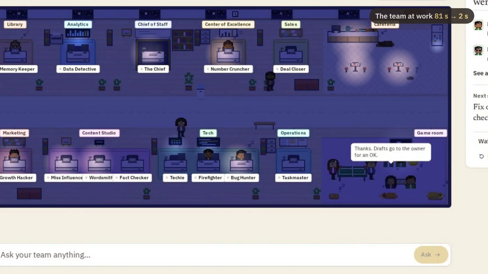

Being a founder isn't easy. Hundreds of things land on your plate every day, and getting all that context to your team is
a job of its own.

Allevia is our answer, and our entry for Graph Hacks: Context for AI Agents, FalkorDB's hackathon. We built it in four
days, 15 to 18 October 2026, in more than 800 commits. Here is what we built, how it works, and what it saves.

## The problem: context lives in one head

**Every "why" in a small business comes back to the founder, because the context lives nowhere else.**

Why a price changed. What was promised to which client. Which post brought the enquiries. The founder knows. The team
mostly doesn't, and the tools never do.

The inbox doesn't know about the analytics. The ad account doesn't know the checkout is broken, so it keeps spending.

Most AI tools don't fix this. They start each chat from nothing, or from a pile of pasted documents.

## What we built

**A company brain per business, and a team of 13 AI agents that must read it before they act.**

Each business gets one FalkorDB graph. It is built from the website, the founder's connected tools, uploaded documents and
conversations. Every fact keeps its source and its date.

The team works in nine departments: The Chief, Data Detective, Growth Hacker, Miss Influencer, Techie, Firefighter, Bug
Hunter, Memory Keeper, Wordsmith, Fact Checker, Number Cruncher, Deal Closer and Taskmaster. The Chief takes each request
and decides who does what. Each agent's instructions say what to read in the brain first, before any outside tool.

Nothing goes out without the founder's OK. A post, an email, a fix or an ad change arrives as a card, on the web or in
Discord.

The live demo has three businesses:

- **Aamdani**, our own startup, with Gmail, Analytics, Search Console and Instagram connected for real.
- **AVS Atelier**, an architecture and interiors studio, built from its website and Instagram.
- **Blue Tokai Coffee**, a known brand. Its public data is real. Its private side (orders, payments, ad spend) is sample
  numbers, labelled as samples on every screen.

## Why a graph, not just vectors

**The honest answer to "why" is a path, and paths live in a graph.**

Listen to what founders ask. "Why did online orders drop this week?" "What breaks if the Instagram token expires?" "Why did
we stop posting daily stories?"

None of these is a lookup. Each answer is a chain: from a number, to the step that fell, to the release that changed it, to
the person who owns the fix.

Vector search finds text that sounds like the question. That is a good place to start. But it can't tell you that a payment
error began the day of a release, or that the release changed the payment page. Those are links.

So we use both. Search finds where to start. The graph explains.

## Architecture at a glance

**One server for the team, one FalkorDB for the brains, and the founder's tools at the edge.**

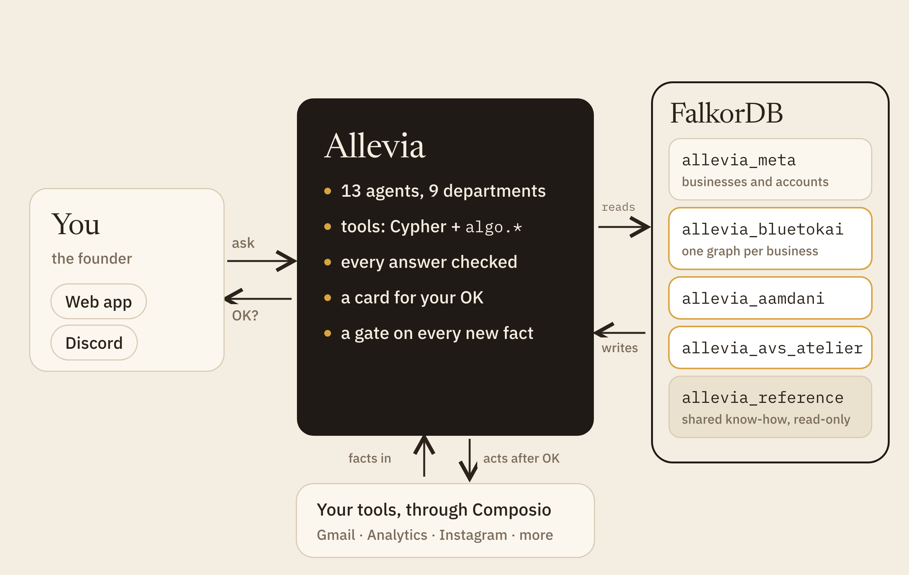

The founder talks to Allevia on the web or in Discord. The server runs the 13 agents (on the Claude Agent SDK), their graph
tools, the answer checks and the approval cards.

Every read an agent makes goes to FalkorDB as `GRAPH.RO_QUERY`, so the database itself refuses a write. Writes go through
our own upsert code and a gate.

The founder's tools connect through Composio. Facts flow in from them, and actions go out through them only after an OK.

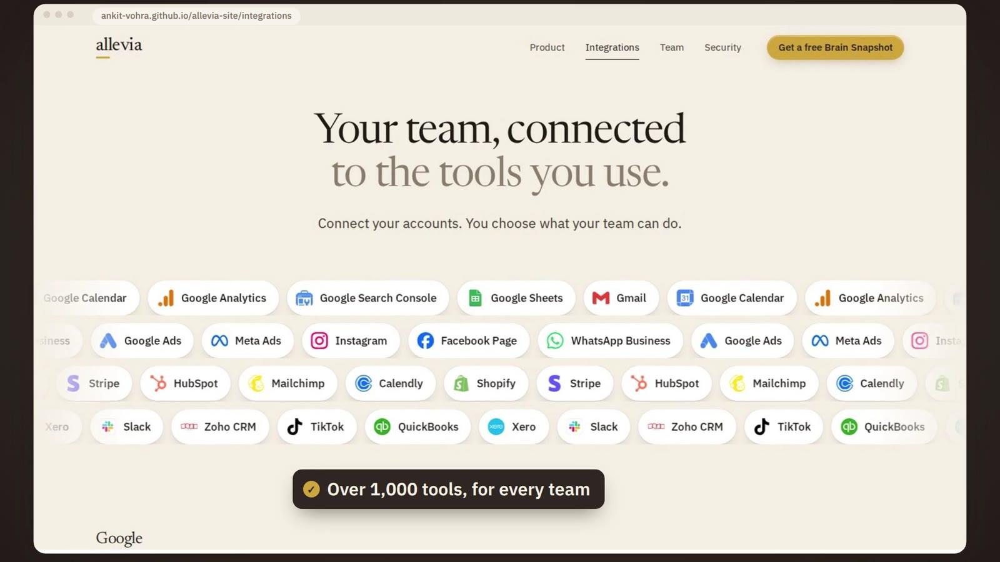

## One graph per business

**Isolation is the graph boundary, not a `WHERE` clause.**

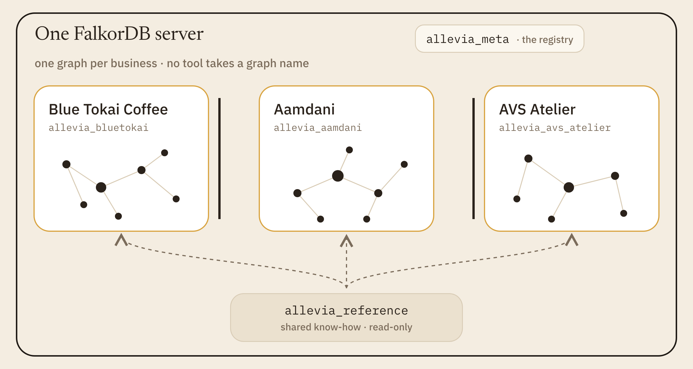

Each business is its own graph, named `allevia_<slug>`. No query in the product filters by tenant, and no agent tool
accepts a graph name. A request is bound to one graph before any tool runs.

Two more graphs sit beside them. `allevia_meta` is the registry: one `Tenant` node per business, plus accounts, sessions
and invites. `allevia_reference` holds general know-how, such as playbook rules, once for everyone, read-only.

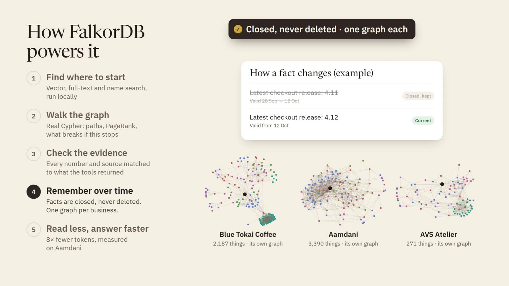

When we recorded the demo, Blue Tokai's graph held 2,187 things, Aamdani's 3,390 and AVS Atelier's 271. Each one can be
exported, measured (`GRAPH.MEMORY USAGE`) or erased on its own.

## Schema in numbers

**A small, strict schema: every node has a type, every edge has two clocks and a source.**

| What | Count | Where |
|---|---|---|
| Node types | 46 | `ENTITY_TYPES` in `src/graph/schema.ts` |
| Relationship types | 68 | `REL_TYPES` |
| Allowed (from, type, to) patterns | 386 | `ALLOWED_PATTERNS`; anything else is refused |
| One-holder relationships | 7 | `FUNCTIONAL_RELS` |
| Bookkeeping properties on every edge | 11 | `EDGE_META_PROPS` |
| Indexes per business graph | 12 | `INDEXES` in `src/graph/indexes.ts` |

Every node carries two labels: `Entity` and its type, such as `Task`. The id index sits on `Entity.id`, with UNIQUE and
MANDATORY constraints. That one index serves every lookup by id, whatever the type.

A third label, `Searchable`, goes on 43 of the 46 types. It leaves out number readings (`Observation`), old versions and
text chunks. The full-text and vector indexes sit on `Searchable`, so search only holds what search may return. We learned
this the hard way: readings each had a display name, a business adds about 160,000 a year, and they crowded real things out
of the ranking.

## How a turn runs

**Plan, work in parallel, review, revise once, answer, then check every claim.**

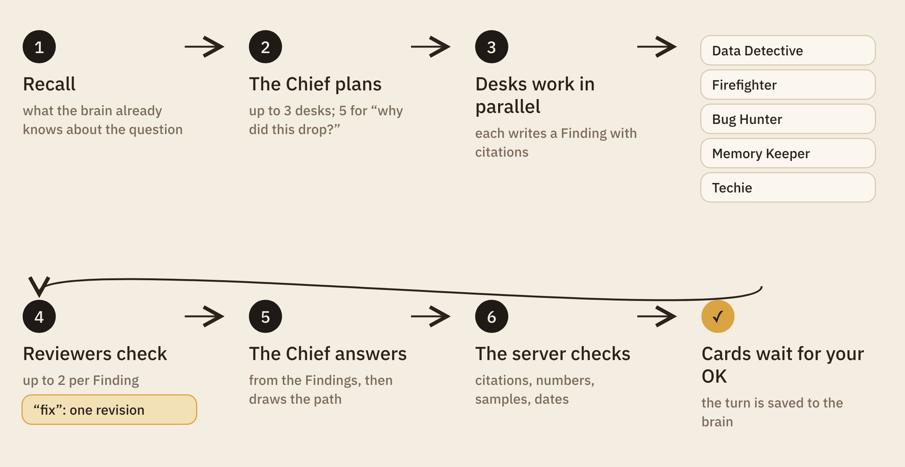

1. **Recall.** The server reads what the brain already knows: earlier turns on the same things, notes, open cards.
2. **Plan.** The Chief picks up to three desks for an ordinary question, and up to five for a "why did this drop?" or a
   review of the whole business.
3. **Work.** Desks run in parallel, each with only its own tools. Each writes a `Finding` node with citations. That
   node is the handoff.
4. **Review.** Each Finding gets at most two reviewers. Number Cruncher checks figures, Fact Checker checks claims,
   Wordsmith checks voice, Bug Hunter checks Techie. A "fix" earns exactly one revision.
5. **Answer.** The Chief writes the answer from the Findings, then calls `show_path` with the nodes that explain it.
6. **Check.** The server checks citations and numbers against what the tools returned in this turn.

Then the cards wait, and the turn is saved to the brain: the `Turn`, every `Finding`, every node it touched and cited.

## Every team, one brain

**Connecting the tools is not about more dashboards. It is so what one team learns reaches the others.**

Allevia connects through Composio, whose catalogue has over 1,600 tools: mail, calendars, analytics, ads, shops, CRMs.
Whatever comes in lands in the same graph, so the ads team, the content team and the website team read the same facts.

On Blue Tokai we asked one question: "What did our ads and posts teach us this month, and what should content, ads and the
website team each do next?" Seven teammates answered together in 102 seconds.

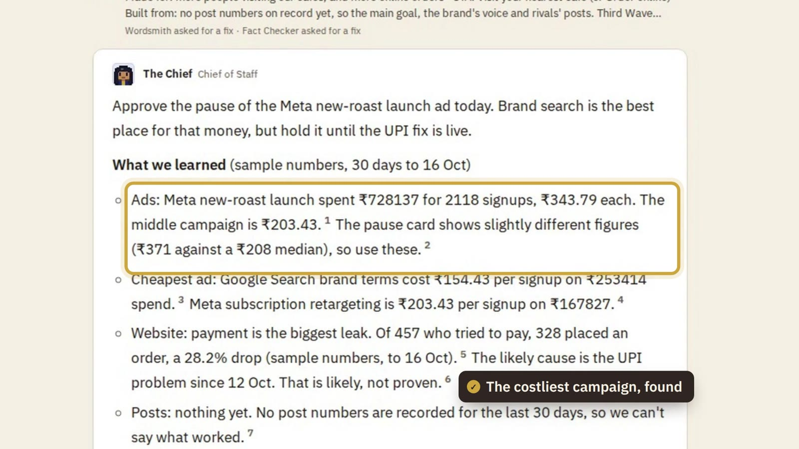

- **Ads** found the costliest campaign, the new-roast launch, at about 1.7 times the middle campaign's cost per sign-up.
  It was sending people to a checkout that was failing UPI payments. Growth Hacker proposed a pause, and moving the money
  to brand search.
- **Content** drafted test posts, each ending with the business's main goal: "Visit your nearest café". Fact Checker
  caught one caption that implied a free tasting.
- **Website** got the payment fix, and a Contact page fix ranked by how much it costs café visits.

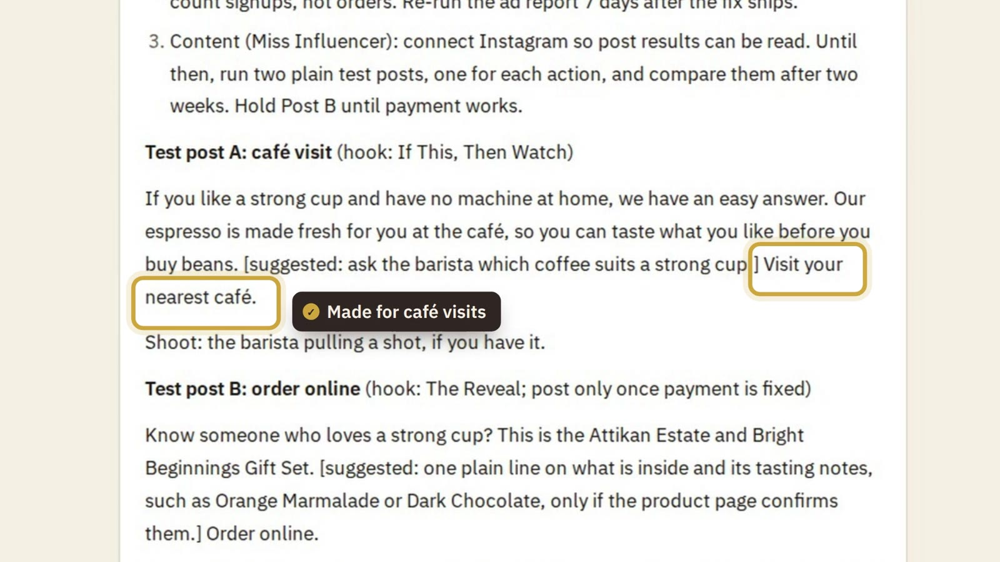

All three wait for the founder's OK. The numbers here are Blue Tokai's sample numbers, and the answer says so.

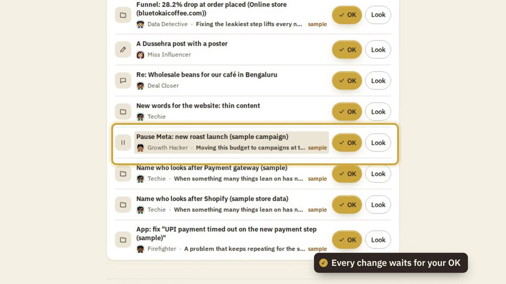

## How retrieval works

**Search finds where to start, Cypher walks the links, the server checks the claims, and the path is drawn.**

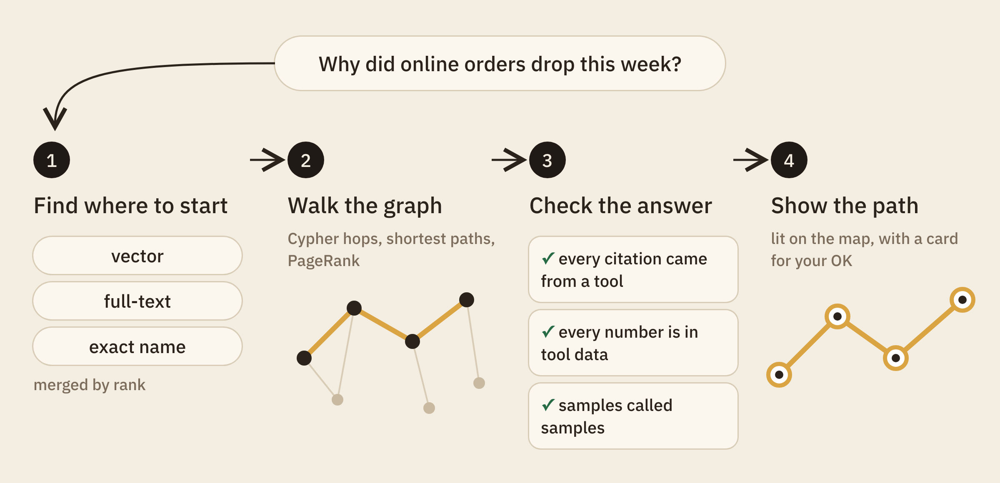

### 1. Find where to start

There are three entry points: vector search (by meaning), full-text search (by words), and an exact name. Embeddings, the
numbers behind vector search, are 384 numbers per text, from a multilingual model that runs on our own server. No API
call, no cost per search.

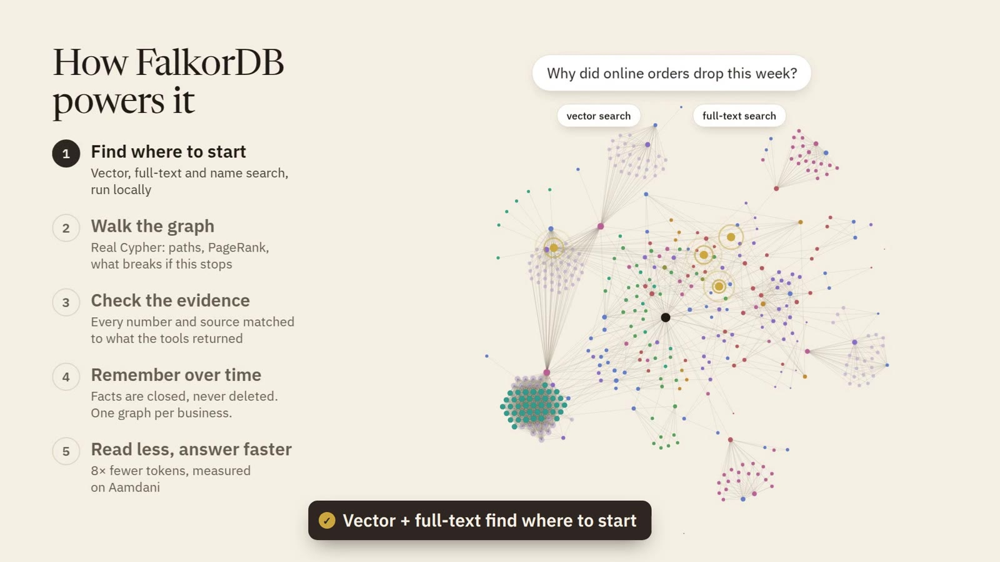

Here are two of the four searches the `search` tool sends at once, from `src/agent/tools/search.ts`:

```cypher
CALL db.idx.fulltext.queryNodes('Searchable', $q) YIELD node, score
WITH node, score WHERE any(l IN labels(node) WHERE l IN $types) AND NOT node:Chunk …
RETURN … ORDER BY score DESC, node.id LIMIT $k

CALL db.idx.vector.queryNodes('Chunk', 'textEmbedding', $k, vecf32($v)) YIELD node, score
OPTIONAL MATCH (d:Document)-[:HAS_CHUNK]->(node)
RETURN … ORDER BY score ASC, node.id
```

A matching chunk answers as its source document, so citations point at sources. The `node.id` at the end of each
`ORDER BY` is load-bearing; the war stories say why.

The result lists are merged by reciprocal rank: each hit scores one over (60 plus its rank) in every list it appears in.
It needs no tuning, and it doesn't care that vector and full-text scores live on different scales.

```ts
const RRF_K = 60;
// …
const add = (key: string, node: NodeRow, rank: number, via: string, extra: Partial<Hit> = {}) => {
  const h = hits.get(key) ?? { node, score: 0, via: new Set<string>(), snippetRank: Infinity };
  h.score += 1 / (RRF_K + rank);
  h.via.add(via);
  // …
};
fuseEntities(ftE, "text");
fuseChunks(ftC, "chunk-text");
fuseEntities(vE, "vector");
fuseChunks(vC, "chunk-vector");
```

An unknown name comes back as "I don't have that in your records", never as an empty walk that reads like "nothing depends
on it".

### 2. Walk the graph

The agents have 21 graph tools, and every one is a Cypher query or a graph algorithm. "What breaks if this stops" is one
query per hop over `DEPENDS_ON`, `AFFECTS` and `BLOCKS`, so the app can show one step away next to four steps away.

The links behind an answer come from FalkorDB's shortest-path procedure, from `src/graph/algorithms.ts`:

```cypher
MATCH (a:Entity {id:$from}), (b:Entity {id:$to})
CALL algo.SPpaths({sourceNode: a, targetNode: b, relDirection: 'both', maxLen: $maxLen, pathCount: $pathCount,
  relTypes: $rels, costProp: 'closedCost', maxCost: $maxCost})
YIELD path RETURN path
```

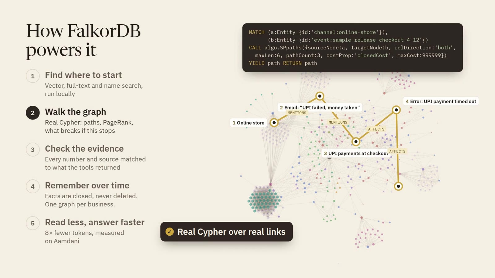

PageRank, a score for how much of the business leads to a thing, ranks what matters. It runs on a cached copy of the graph
that holds current edges only (explained in the memory section). FalkorDB caps a result at 10,000 rows, so the scores come
back packed into lists of 5,000:

```cypher
CALL algo.pageRank('Searchable', null) YIELD node, score
WITH node.id AS id, score AS v WHERE id IS NOT NULL
WITH collect([id, v]) AS xs UNWIND range(0, size(xs) - 1, $page) AS i RETURN xs[i..i + $page] AS part
```

Agents can also write their own Cypher, through one tool with five guards, from `src/agent/tools/cypher.ts`:

```ts
const READ_PROCS = new Set([
  "db.labels", "db.relationshiptypes", "db.propertykeys", "db.indexes", "db.constraints", "db.meta.stats",
  "db.idx.fulltext.querynodes", "db.idx.fulltext.queryrelationships", "db.idx.vector.querynodes", // …
]);
// …
const reason = writeReason(base, args.params); // no write keyword, only READ_PROCS, no reduce()
if (reason) throw new InputError(reason, { refused: true });
const bounded = boundRows(groupInWith(base), args.params, CYPHER_ROW_CAP + 1);
raw = await ro(ctx, bounded.query, bounded.params, CYPHER_TIMEOUT_MS); // GRAPH.RO_QUERY, 5 s
```

The text check comes first. `GRAPH.RO_QUERY` is the guard that can't be talked around.

### 3. Check the answer

Before the founder sees an answer, the server checks it. Every `[[node-id]]` the answer cites must have been returned by a
tool in this turn. Every number must appear in the tools' data, allowing for rounding, percentages, "55k" and "₹1.2 lakh".
An answer that used sample data must say so, and one built on data over a week old must say "as of" a date.

A failed check never hides the answer. It shows as "unverified", and the result is stored on the turn.

### 4. Show the path

The Chief names the nodes behind the answer, in order. For each pair, the server looks for a direct edge, then a shortest
path of up to four hops, and only through the business's own records, not through Allevia's own cards. The app lights that
path on the map.

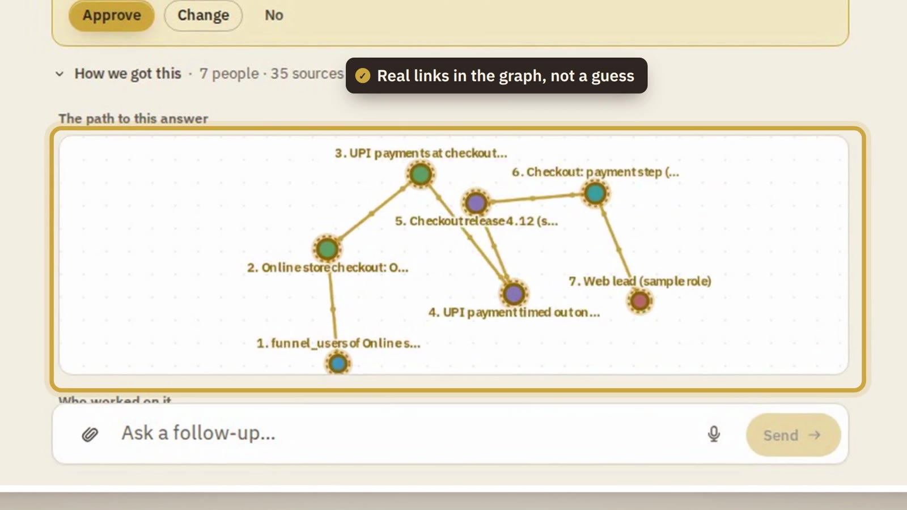

On Blue Tokai, "Why did online orders drop this week?" walks from the online store to the UPI payment step, the payment
error, and the checkout release that brought it. Those numbers are samples, and the answer says so.

## Memory with two clocks

**Nothing is deleted. A fact that stops being true is closed with a date and kept.**

A business changes its mind all the time. A task changes hands. A decision replaces an older one. If memory overwrites,
the agents end up confidently wrong.

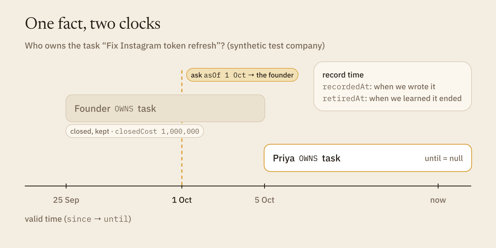

So every edge carries two clocks. Valid time (`since`, `until`) says when a fact was true. Record time (`recordedAt`,
`retiredAt`) says when we learned it, and when we learned it had stopped. Every edge also carries its source (`src`) and its
date (`asOf`).

Every tool takes an `asOf` date, so "who owned this task on 1 October?" has a real answer. In our synthetic test company,
the task "Fix Instagram token refresh" is owned by Priya now; ask as of 1 October and the answer is the founder.

Closing an edge is one `SET`, from `src/graph/edges.ts`:

```ts
const CLOSE_SET = (v: string, reason: string) =>
  `SET ${v}.until = CASE WHEN ${v}.since > $end THEN ${v}.since ELSE $end END, ${v}.retiredAt = coalesce(${v}.retiredAt, $now), ` +
  `${v}.retiredAsOfMs = coalesce(${v}.retiredAsOfMs, $endedAsOf), ${v}.closedCost = $cost, ${v}.closeReason = ${reason}`;
```

Some facts can only have one holder at a time. A task has one current owner. A decision is replaced by at most one
successor. Seven such rules live in the schema:

```ts
export const FUNCTIONAL_RELS: FunctionalRule[] = [
  { rel: "OWNS", toType: "Task", key: "to", why: "a task has one current owner" },
  { rel: "SUPERSEDES", key: "to", why: "a decision (or rule, doc…) is superseded by at most one successor" },
  // …
  { rel: "DERIVED_FROM", fromType: "Asset", key: "from", why: "an asset has one parent: the one it was made from" },
];
```

The edge write is a single Cypher statement of about 50 lines. It reads the current and closed edges, finds a replay, and
closes the old holder of a one-holder slot in the same statement as it opens the new one. Facts can arrive in any order;
an older source never overrules a newer one. Re-running an ingest adds nothing.

When a task, a decision or a goal changes, its old state is saved as a `Version` node one hop away. Readings are never
overwritten either: each is its own `Observation` node, with a time window, a date and a source.

One FalkorDB detail shaped all of this. The `algo.*` procedures take labels and relationship types, but they can't filter
on edge properties, so they would walk a closed edge. Our fix has two halves:

- A closed edge carries `closedCost = 1,000,000`, and the shortest-path call sets `maxCost` just under it. Closed edges are
  pruned inside the search.
- PageRank and topic grouping run on a slim copy of the graph with current edges only. Building it ourselves took about
  110 ms at 20,000 nodes, against 5.3 seconds for `GRAPH.COPY`, which also rebuilds every search index. The copy is cached
  until a write lands.

Meetings are memory too, and they arrive by themselves. A call recorded by Fireflies or Granola (or a transcript sent to
the business's own meeting address) becomes minutes with nobody pasting anything. Every line of the call is a `Chunk` of the
transcript, linked to who said it; each decision is `BASED_ON` the line it was agreed in, and each action points back at the
line it came from. The action goes to the right teammate (a quote to Deal Closer, a checkout fix to Techie), and the minutes
email waits for the founder's OK. Open any task and you see the exact words that created it.

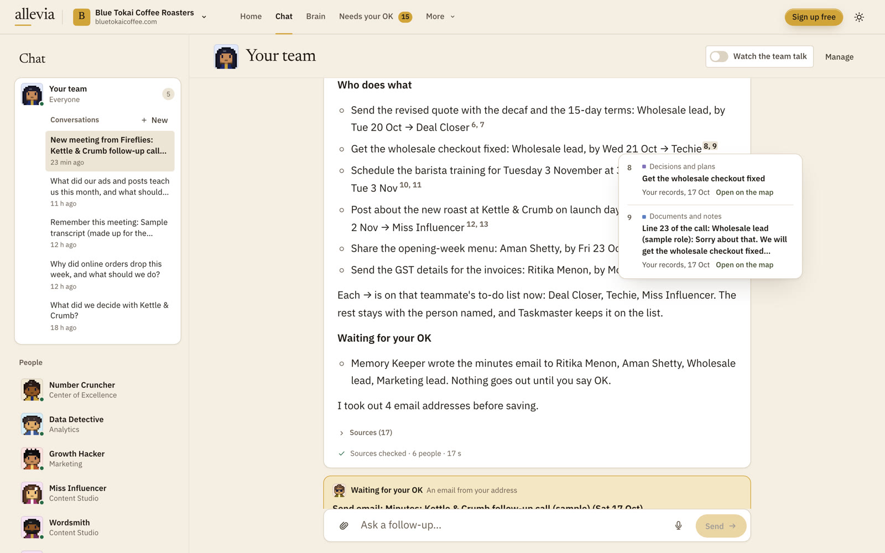

## Keeping the brain clean as it grows

**A brain that only grows gets slow, costly and noisy. So every write passes a gate, and the brain tidies itself.**

- **A shared reference graph**, `allevia_reference`, read-only and loaded once. General know-how, such as about 200
  playbook rules, lives there once instead of in every business. A business keeps a small stub of a shared rule only
  when one of its own facts points at it, so citations still resolve.
- **A write gate.** Every new node needs a known type, a source and a date, or it is refused and logged.
- **Entity resolution on write.** A new person, business or product that matches an existing one by name or email is
  linked to it, not created again.
- **Weekly roll-ups and an archive.** Old daily readings roll up into weeks the way their readers total them (sums for
  flows, means for rates), and old closed facts move to an archive. Both run as a dry run first and can be undone.
- **A hygiene report and size budgets.** Closed facts, old readings, cold and over-linked nodes, per business.

The gate's core, from `src/graph/gate.ts`:

```ts
export function gateNode(n: NodeInput, o: Pick<GateOpts, "src" | "asOf">): NodeInput {
  if (!isEntityType(n.type)) throw new RefusedWrite(`unknown label ${JSON.stringify(n.type)}: not in the schema`);
  const src = n.src ?? o.src;
  const asOf = n.asOf ?? o.asOf;
  if (!src) throw new RefusedWrite("no source (src): every new node says where it came from");
  if (!asOf) throw new RefusedWrite("no date (asOf): every new node says as of when");
  return n.src === src && n.asOf === asOf ? n : { ...n, src, asOf };
}
```

## How fast it is

**Walks take milliseconds, even on a graph many times our biggest business.**

We timed the tools on FalkorDB 6.0.2, on a laptop, on a graph built for timing: 37,240 nodes and 49,983 edges.

| Query | Time |
|---|---|
| What breaks, 1 step / 4 steps | 5–16 ms / 7–36 ms |
| Up to 3 shortest paths, 6 hops | 135–218 ms |
| PageRank, first call / cached | 696 ms / 12 ms |
| Topic groups (label propagation) | 136 ms |
| Full-text search | under 1.2 ms |

The walk is never the slow part. The model is.

## What we measured: 8× fewer tokens

**On a real business, one agent on the graph read 8× fewer tokens than pasting the documents, and finished faster.**

We tested that on 17 October, on Aamdani, with two real questions: "What breaks if
the Instagram token expires?" and "Why did we pause daily stories and image posts?"

Each question was answered two ways, with the same model and rules: with all 114 of the business's documents pasted into
the prompt, and by one agent with only the graph tools.

> **8×** fewer tokens than pasting the documents: 75,000 against 604,000

| Way of answering | Tokens read, both questions | Time | Against pasting |
|---|---|---|---|
| Paste all 114 documents | 603,665 | 44 s | the starting point |
| One agent on the graph | 75,043 | 25 s | 8× fewer tokens, 43% less time |

Tokens are the units a model reads and is billed by. The agent's tools handed it only 1,200 to 2,100 tokens of the
business's own records per answer.

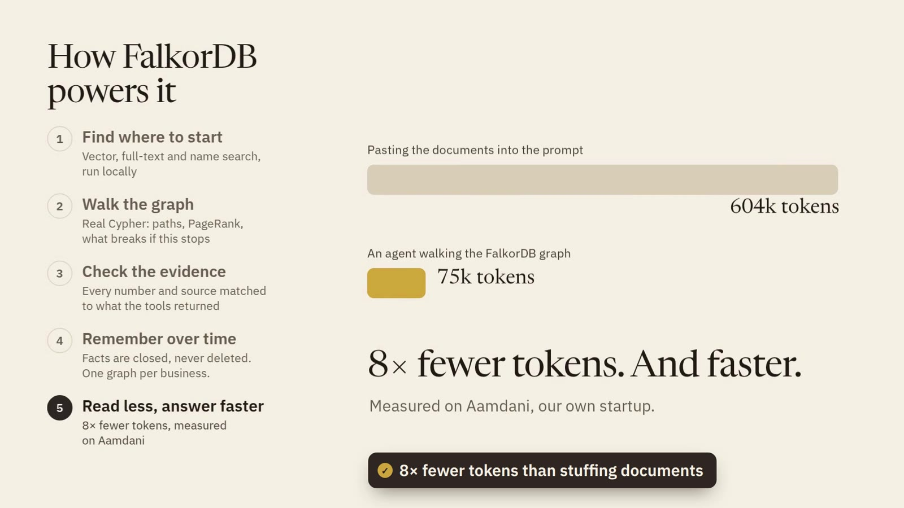

## Try it

- **Demo video (2:50):** https://youtu.be/fxCLRLmyP2M
- **Live:** https://13-232-139-42.sslip.io. Sign up for 100 free credits, or open "See the demo".
- **Code:** https://github.com/Ankit-Vohra/allevia-company-brain
- **Every query and algorithm**, with its file and line: `docs/falkordb-queries.md` in the repo.
