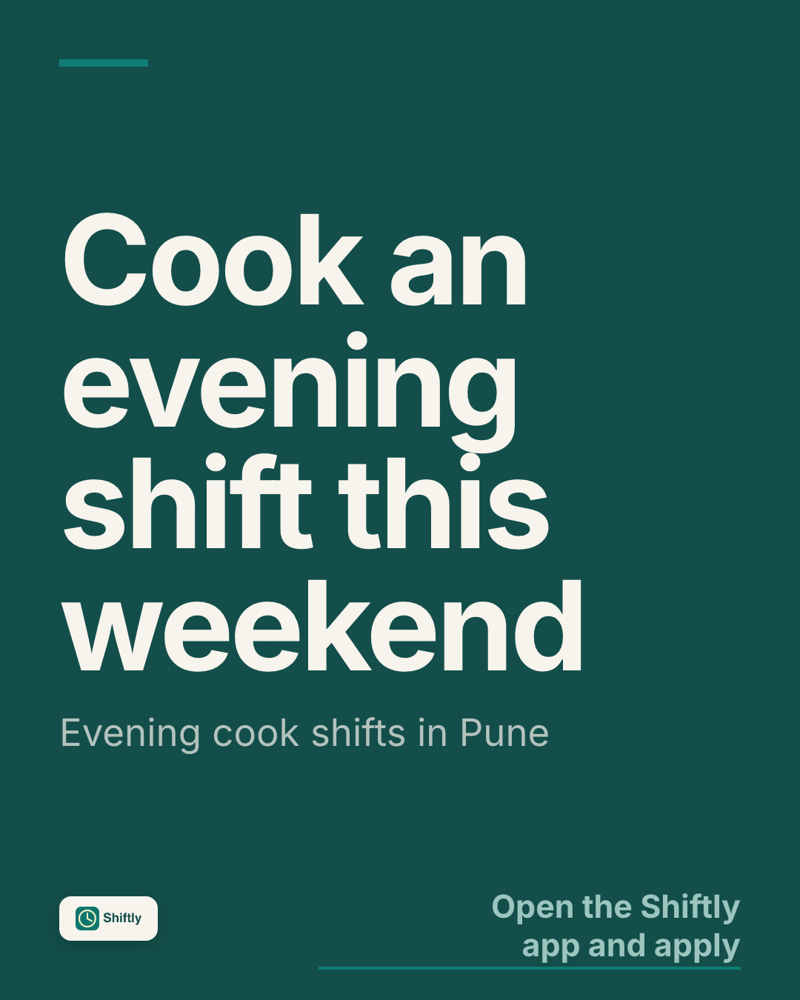

# The five live scenarios

What "live" means here: real agents on the Claude subscription, the real graph, the real code, nothing played back, no fakes.
Where something was a recording or a fake, the line says so. Written on **16 October 2026** from the runs of 15 and 16 October.

Evidence comes in two kinds. **Shiftly** is the synthetic business that ships with this repository, so its transcripts and
screenshots are here (`docs/demo-screens/`, [`docs/evals/2026-10-16-demo_growth.md`](evals/2026-10-16-demo_growth.md)). The
**real businesses** (the founder's own, kept private) were also run; their screenshots, reports and drafts are in the private
repository, so they are named below as results and not linked.

| # | Scenario | Result | Still needs the founder |
|---|---|---|---|
| 0 | The hero: "Why did sign-ups drop this week, and what should we do?" | **Pass.** 5 of 5 live on Shiftly and 5 of 5 on a real business; four answers re-run live on a clean copy on 16 Oct, all checks green | Nothing |
| 1 | Onboard a company from its URL | **Pass, after a fix.** The web path failed twice on one site, was fixed, and then worked; it takes about 8 minutes, not 2 | Nothing |
| 2 | An unscripted question on Discord, answered with its path | **Partly.** The founder asked live on 15 Oct and found six faults, since fixed; no live run since the newest changes (fake ports only) | An unscripted question typed in the hub from his own account |
| 3 | "Poster for Insta with my logo" | **Works, plain.** On Shiftly (a made-up logo): it asked what the poster is for, then made one with the logo whole and the owner's exact words, waiting for OK; its own design review said 3.7 of 5. Real-business posters scored 4.1 and 4.6 | His verdict on the design; AVS Atelier's logo file |
| 4 | A bad photo turned into good content | **Pass**, live engine on 15 Oct, free path on 16 Oct. The edit that invented things was held back | Nothing |
| 5 | The team notices something on its own and drafts it | **Pass.** The stand-up ran live on both real businesses; on Shiftly the detectors find the crash and the team leads Today's note with it | Nothing |

## 0. The hero

**Run:** the question as an owner would type it, in the web app, on Shiftly, from a clean export of this repository on a machine
that had never run it. **When:** 16 Oct, 19:37 to 19:41 IST. **Cost:** subscription time only.

Four questions, one after the other, each a new thread: the hero, "What else breaks if the sign-up screen keeps crashing?",
"Did pausing the Meta ads cause the sign-up drop?" and "What did people say about the new phone-number box in their store
reviews?" (a question with no records behind it).

| Question | Time | Who worked | What it did |
|---|---|---|---|
| Why did sign-ups drop this week, and what should we do? | 92 s | Meera, Kabir, Zoya, Imran, Sara, Isha, Arjun | Cause (the phone-number field that came with 2.8.0 crashes the sign-up screen), chain with dates, how sure, what is not recorded, where the fix stands, two cards waiting for OK |
| What else breaks if the sign-up screen keeps crashing? | 58 s | | Depth 1 against depth 4 from `impact_of`: the next steps, then job-alert texts, referral invites, the employer inbox; Farhan owns the screen; owners of the rest "not recorded" |
| Did pausing the Meta ads cause the sign-up drop? | 49 s | | "Almost certainly not": the fall began on 7 Oct, the pause was on 10 Oct; ad numbers called sample numbers; keeps Meta off until the fix is live |
| What did people say about the new phone-number box in their store reviews? | 35 s | | "Not recorded": no store reviews in the records; says what to export; invents no quote |

All four passed every check (citations valid, numbers grounded, sample numbers disclosed, dates disclosed, mode disclosed).
Honest note on variance: a first take of the depth question, run earlier the same hour, **failed two checks** (it named the ad
campaign without saying its figures are sample numbers) and showed the "unverified" badge; it was not kept, and the re-run
passed. Answers differ in wording and detail from run to run; the cause and the path do not.

These four are what [`seed-demo --recorded`](../src/demo/recorded) replays in the public read-only mode, so a judge without a
Claude login sees them, work log and path included. Screenshots:
[the answer](demo-screens/hero-answer-desktop.png), [the path](demo-screens/hero-path-desktop.png),
[depth 1 against 4](demo-screens/brain-desktop.png), [the cards](demo-screens/approvals-desktop.png).

**Earlier, as an eval** (`evals/hero.yaml`, 16 Oct): the hero question passed 5 of 5 on Shiftly (69 to 102 s) and 5 of 5 on a
real business whose records cannot prove the cause (60 to 85 s; the pass there is the honest "cause not shown"). The other
items in the set each passed on a live run. Report: [`docs/evals/2026-10-16-demo_growth.md`](evals/2026-10-16-demo_growth.md).

## 1. Onboard a company from its URL

**Run:** the web app's Add a business (`/onboard`), a public website, a country; and the same from the command line
(`npm run onboard`). **When:** 15 and 16 Oct.

- **15 Oct, seven public sites nobody had hand-tuned** (a dentist, a café, an analytics SaaS, a garden centre, three
  restaurants and cafés in three languages): six onboarded without any site-specific code, in 1 to 13 minutes, and the profile
  and brand voice were right on all six. One site blocked the crawler (it answered "slow down"), and the run now says so in plain
  words and stops. Seven generic faults were found and fixed
  ([`onboarding-trials.md`](onboarding-trials.md)).
- **15 Oct, a business's own site** (the founder's second business, from nothing but its URL): built its brand kit, SEO checks,
  services, audiences, goals and plan.
- **16 Oct, from the web app:** Prufrock Coffee (prufrockcoffee.com, a London café) **failed twice** with "the page has almost no
  text we could read", although the command line, a different process, read it fine (20 pages). The crawler's browser could not
  start inside the long-running server. Fix: retry the launch, read the pages' HTML when the browser still will not start, say
  honestly when a site really is unreadable, and log the crawl. Re-run: **onboarded from the web app**, verified live.
- **16 Oct, the product audit:** a fresh public site into a new business through the web app: 40 pages, 464 facts, 3 goals, 12
  people, **477 s**, then deleted ([`product-audit.md`](product-audit.md)).

**Honest limits.** The page says "about two minutes"; a real site takes about 8. The crawl reads at most 40 pages in 5 minutes.
On day one every goal reads "we'll know after your first full week", because nothing is connected yet: the team knows the
website and nothing else until a number arrives. The onboarding is not re-run on the clean copy in the hero run above;
Chromium for the crawler is a separate install (`npx playwright install chromium`), and without it the HTML reader is used.

## 2. An unscripted question on Discord

**What exists:** the bot (a thread per conversation, a live work log, approval buttons on cards that carry their full content,
`/ask`, `/brief`, `/approvals`, `/connect`), a hub that serves each customer in their own channels
([`docs/discord-hub-setup.md`](discord-hub-setup.md)).

- **15 Oct, live, by the founder:** he dropped a photo in `#studio` and asked a question in `#your-team`. He found six faults
  (an English question answered in Hinglish, the Studio looking like code, "make it festive" refused, every face blurred, a
  child stopping the run, "[you tell us: ...]" left in five of seven posts). Each was fixed with a test.
- **16 Oct, the audit:** every Discord path was exercised **with fake ports only** (233 tests: asking, the brief, approvals with
  Approve / Change / No thanks, Studio buttons, spreadsheet upload, hub isolation, join links, the database waking up). Nothing
  was posted to the real hub, so the newest approval cards have not been seen in a real channel.
- **The same engine, live, in the web app:** the answers in scenario 0 come from the function Discord calls (`ask()`), so the
  question-to-answer-to-path part is proven live; what is not is the Discord surface itself since the changes of 16 Oct.

**Not run:** a stranger's unscripted question on Discord. **Needs the founder:** type one in the hub from his own account
(for example "what breaks if the Instagram connector goes down?"). Before that, drag the bot's role above every `customer-*`
role in the server (Server Settings, Roles), or a new customer cannot be given their role: `discord-hub status` fails on it
today.

## 3. A poster with the owner's logo

**Run on Shiftly (16 Oct, about 19:55 IST):** a made-up logo (a teal rounded square with a clock, [`shiftly-logo.png`](demo-screens/shiftly-logo.png))
filed through the product's own upload path; the librarian looked at it and answered "Got your logo. I'll put it on every poster
and ad". Then, as an owner would write it: **"Poster for Insta with my logo"**.

**First answer (20 s): it asked instead of inventing.** The team found the logo, noted that no brand font files were on file, and
said: "I haven't made the poster yet. I don't know what it should sell, and I won't make up an offer or a line", then asked three
things (what it is for, the one line, what people should do). That is the purpose-first rule: no poster without a purpose.

**Second answer (50 s): the poster.** With the purpose given ("cooks for evening shifts in Pune this weekend; the line: Cook an
evening shift this weekend; people should open the Shiftly app and apply"), Meera made it herself with `make_poster`, Rohan
reviewed the design and Nisha checked every word:



- The owner's line is the headline, exactly as given; the call to action is the owner's; the support line adds only "Pune".
  **No pay, hours or offer** were added, because none was given, and the answer says "if you have a pay rate or shift times,
  send them".
- The logo is the filed file, **whole**, bottom left.
- Nisha: all the words are present and spelled right. It waits for the owner's OK as a card (`content_draft`); nothing was posted.
- **The team's own design review scored it 3.7 out of 5 and said it did not fully pass:** the support line repeats the
  headline, and the call to action is small, pale text in a corner that is easy to miss on a phone. Without brand font files
  it set the words in Inter; without brand colour codes it took its colours from the logo. I agree: it is clean, on-brand and
  plain, and not yet a poster a designer would sign.
- **Cost: 0 credits.** The paid image engine was switched off for this run (`ALLEVIA_STUDIO_ENGINE=recorded`), so the poster is
  type and logo on the brand's colour, with no generated picture underneath.

**Real businesses (15 and 16 Oct, private).** Posters, an ad and a 14-second reel were made live for two real businesses from
purpose-first briefs, on the business's own photos and app screens, in its fonts (Hindi too), by HTML and CSS rather than by
asking an image model to draw words. The team's own review scored the best options **4.1 and 4.6 out of 5**; one option scored
3.8 and the card said so. The founder's verdict on 16 Oct: "decent for now; improve further after the hackathon". Credits spent:
12.88 of the agreed budget. **Gaps, all known:** the reel has no voice-over, one business has no logo file yet (so its
posters use its name in its font), grid labels can cover rooms in a photo ad.

## 4. A bad photo turned into good content

**Run:** a photo dropped into the Studio (web) or `#studio` (Discord) with a one-line note. **When:** 15 Oct, live engine; 16 Oct,
on Shiftly in the audit (a photo, Tara's read, options A and B, Nisha's check, the caption, approve: 32 s).

- Every photo gets two options. **A** is the free clean-up (straighten, crop, light) done locally. **B** is an AI edit from the real
  Higgsfield engine, **priced first** ("about 2 Studio credits") and capped per edit, per clip and per day.
- **Live check, 15 Oct, on the founder's Higgsfield login (15.5 credits of 16 agreed):** on a crop of a business's own public
  website photo, A straightened it but shifted the colour the wrong way; B (2 credits) gave warm light and a clean sky with every
  arch and window in place, and Nisha marked it unchanged and chose it. "Make it festive for Diwali" produced a lovely festive
  scene that Nisha **held back**, because it removed a plant and some window bars. A 5-second 9:16 clip (7.5 credits) was an
  explicit, priced extra.
- **What the team does not do:** invent. People in a photo are kept as they are; a photo with a child gets the free clean-up only.

**Honest limits.** The generated edit costs credits, so demos replay a recorded edit unless the engine is switched on. Reels need
an editor. Nothing posts: the owner approves a caption and a picture, and the post is theirs to publish.

## 5. The team notices something and drafts it

**Run, real businesses (16 Oct):** `npm run cli -- standup <business>` on both, on the subscription. Meera read what changed, the
dates coming up and the open ideas, the team turned them into opportunities with one-line reasons, Meera picked at most three,
and each waited for the owner's OK with Today's note leading with them. One business got three Hindi drafts (a festival post, a
post in the style of its best reel, a Facebook post after ten silent days); the other a festival poster on paid artwork and
ready-to-paste text for its contact page. 4 Higgsfield credits in all, 2 of them wasted on a poster whose Hindi headline the
brand font could not set (the check refused it after the artwork was paid for; now font coverage is checked first). Seven faults
found, all fixed; follow-ups merged the same day (big fixes lead the note, Hindi-capable fonts, "Change" teaches a rule).

**Run on Shiftly (16 Oct, about 19:50 IST), no model needed for the finding:**

```
npm run cli -- seed-demo demo_notice
npm run cli -- insights demo_notice
npm run cli -- standup demo_notice --no-paid
```

The 20 deterministic detectors found three things and drafted two cards:
Zoya, on call: "An app error is hitting 218 people: TypeError: Cannot read properties of undefined (reading 'country') in
PhoneInput" (406 times in one day); Imran, releases: "Since the app build of 7 Oct: sessions without a crash fell from 99.4% to
92.2%"; Sara: "3 documents nothing links to". The stand-up then wrote Today's note, which opens:

> **Two big things are waiting for your OK; here's why they matter this week**
> 1. An app error is hitting 218 people ...: A crash in PhoneInput hit 218 people 406 times in one day, so those users are likely blocked at phone entry.
> 2. Since the app build of 7 Oct: sessions without a crash fell from 99.4% to 92.2% ...: Crash-free sessions dropped from 99.4% to 92.2% since the 7 Oct build, so more users are hitting crashes now.

**Honest limits.** On a business with nothing to notice the stand-up says so ("Nothing new worth your time today"), which it did
on Shiftly before the detectors had run. Reviews and competitor moves were tested with fakes only (no public data was on file for
either real business). The Discord side of the stand-up (drafts under the note with Approve / Change / No thanks) has been seen
with fake ports only.

## What still needs the founder

1. **Discord:** type an unscripted question in the hub from his own account; first move the bot's role above the `customer-*`
   roles (scenario 2).
2. **Google Calendar for the synthetic business:** open the connect link posted on issue #40 once (it waits 30 minutes; the
   proof script prints a fresh one), so the team can read free times and draft a booking as an approval card. Nothing is booked
   or sent. Until then connections are proven against fakes only.
3. **The design verdict** on posters and reels, and **AVS Atelier's logo file** (scenario 3).
4. **For the submission:** the demo video, the public repository, the decision on screenshots of the real businesses, the
   organisers' answer on founder-owned data, the submission form ([`submission-checklist.md`](submission-checklist.md)).
